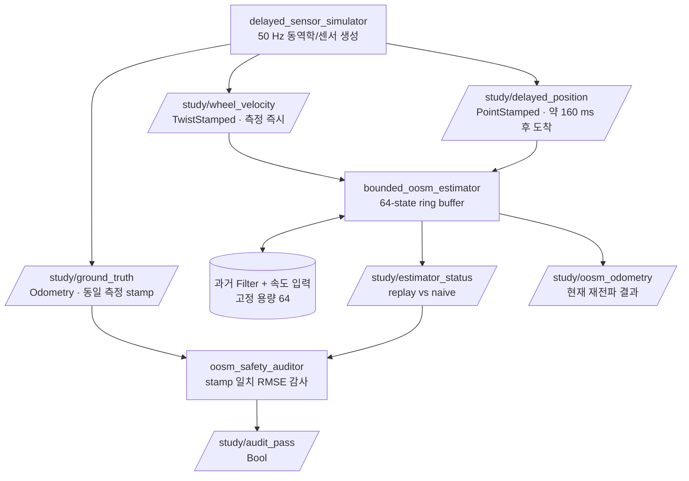
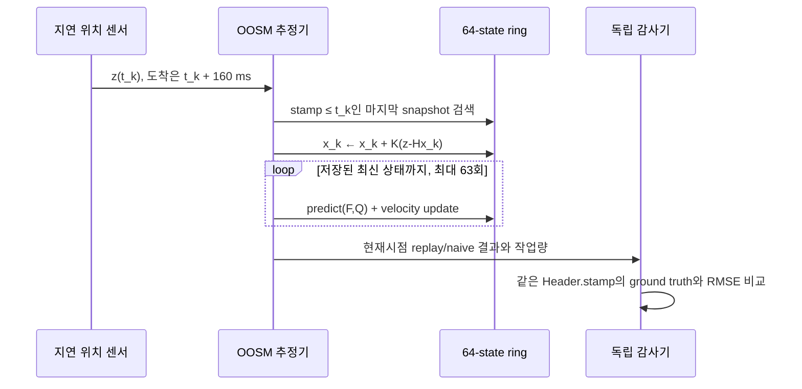

# 2026-10-14 — ROS 2 측정시각과 Bounded OOSM 상태 추정

## 오늘의 핵심 요약

오늘은 **메시지가 도착한 시각과 센서가 실제로 측정한 시각은 다르다**는 사실을 ROS 2 코드와 상태 추정 수식으로 연결한다. 50 Hz 속도 측정과 10 Hz 위치 측정을 융합하되, 위치 메시지는 측정 후 약 160 ms 늦게 도착한다. 잘못된 기준선은 그 과거 위치를 현재 상태에 바로 적용한다. 오늘의 추정기는 `Header.stamp`가 가리키는 과거 상태로 되감아 Kalman 보정을 수행한 후, 저장해 둔 속도 입력을 현재까지 다시 재생한다.

세 영역의 균형은 다음과 같다.

- **기초 실무:** `Header.stamp`, `frame_id`, `TwistStamped`, `PointStamped`, `Odometry`, wall timer와 ROS time의 역할을 구분한다.
- **심화/RT:** `std::array<Snapshot, 64>` 순환 버퍼와 최대 64회 재전파로 메모리와 계산량의 상한을 둔다. 단, DDS와 executor까지 hard real-time이라는 뜻은 아니다.
- **알고리즘:** 1차원 `[position, velocity]` Kalman filter에 out-of-sequence measurement(OOSM) rewind/replay를 구현하고 naive 현재시점 보정과 RMSE를 비교한다.

## 학습 순서 (Reading Order)

1. 이 README의 시간 계약과 구조도를 읽는다.
2. [`src/delayed_sensor_simulator.cpp`](src/delayed_sensor_simulator.cpp)에서 측정 시각과 도착 시각을 의도적으로 분리하는 방법을 본다.
3. [`src/bounded_oosm_estimator.cpp`](src/bounded_oosm_estimator.cpp)에서 예측·속도 보정·과거 위치 보정·재전파의 수식과 코드를 연결한다.
4. [`src/oosm_safety_auditor.cpp`](src/oosm_safety_auditor.cpp)에서 동일 stamp끼리만 정답과 추정값을 비교하는 독립 감사를 확인한다.
5. [`paper_review.md`](paper_review.md)에서 2026년 Galilean EqF가 미지의 GNSS 시간 지연을 어떻게 상태로 결합하는지 읽는다.
6. 누적 노트 [`knowledge/sensor_fusion/oosm_rewind_replay.md`](../../knowledge/sensor_fusion/oosm_rewind_replay.md)와 [`knowledge/realtime/bounded_oosm_buffer.md`](../../knowledge/realtime/bounded_oosm_buffer.md)를 복습한다.

## 시스템 아키텍처



지연 위치 한 건이 들어왔을 때의 상태 변화는 다음과 같다.



## 시간 계약: 네 가지를 섞지 않는다

| 시간 | 이 실습의 표현 | 용도 |
|---|---|---|
| 측정 시각 | `msg.header.stamp` | 어떤 과거 상태를 보정할지 결정 |
| 도착 시각 | 추정기 callback에서 `now()` | message age 계측에만 사용 |
| 주기 실행 | `create_wall_timer(20ms)` | 시뮬레이터 callback을 깨우는 벽시계 기반 스케줄 |
| 실행시간 | `std::chrono::steady_clock` | 재전파 구간의 경과시간 계측 |

`create_wall_timer`가 20 ms마다 정확히 실행됨을 보장하지는 않는다. 진짜 적분 간격은 연속 메시지의 `Header.stamp` 차이로 계산한다. 반대로 callback 실행시간은 ROS time이 pause/jump할 수 있으므로 단조 증가하는 `steady_clock`으로 잰다.

## 알고리즘 직관

상태를 \(x=[p, v]^T\)라고 하고 constant-velocity 모델을 쓰면

\[
x_{k+1}=\begin{bmatrix}1&\Delta t\\0&1\end{bmatrix}x_k+w_k
\]

이다. 속도 측정은 \(H_v=[0,1]\), 위치 측정은 \(H_p=[1,0]\)로 Kalman update한다. 지연 위치 \(z_j\)가 현재 \(k\)에 도착했을 때 올바른 교육용 처리 순서는 다음이다.

1. `Header.stamp`로 snapshot `j`를 찾는다.
2. 그 상태에 \(z_j\)를 보정한다.
3. `j+1 ... k`에 저장된 속도 입력을 시간순으로 재적용한다.
4. 현재 상태를 교체한다.

오늘 구현은 지연 자체가 `Header.stamp`로 정확히 알려졌다고 가정한다. 논문처럼 **미지의 시간 offset을 추정하지 않는다**. 또한 64개보다 오래된 위치는 무한히 메모리를 늘리지 않고 명시적으로 drop한다.

## 빌드와 실행

ROS 2 Jazzy 환경에서 저장소 루트를 workspace로 사용한다.

```bash
colcon build --packages-select daily_robotics_2026_10_14 --symlink-install
source install/setup.bash
ros2 launch daily_robotics_2026_10_14 study.launch.py
```

검증은 다음과 같이 실행한다.

```bash
source install/setup.bash
ROS_DOMAIN_ID=166 bash daily_robotics/2026-10-14/test/smoke_test.sh
```

`/study/audit_status`에서 다음 항목을 확인한다.

- `replay_rmse < naive_rmse`: 지연 측정을 과거 상태에 적용한 효과
- `last/max_replay_steps <= 64`: 계산량 상한
- `dropped_too_old_measurements`: buffer horizon보다 늦은 입력의 명시적 drop
- `max_replay_time_us`: 관측된 실행시간이며 WCET 증명은 아님

## 자체 검증 결과

공식 `ros:jazzy-ros-base` 컨테이너(GCC 13.3, Fast DDS)에서 custom message 생성과 세 C++17 executable의 `colcon build`가 compiler warning 없이 통과했다. DDS domain 166–169에서 통합 smoke test를 네 번 실행했고 모두 통과했다.

- 250개 timestamp-matched 감사 sample의 replay RMSE: **0.001883–0.001906 m**
- 같은 입력을 현재시점에 잘못 보정한 naive RMSE: **0.174551–0.177881 m**
- 정확도 개선: 약 **98.9%**
- 지연 위치 accepted: **56–57건**, window 밖 drop: **0건**
- 최대 replay: **7–8 steps**, 관측 최대 kernel 시간: **5.155–37.478 µs**

이 값은 Docker에서 관측한 회귀시험 sample이며 WCET 또는 hard real-time 증명이 아니다.

## 제품 코드로 확장할 때

- Camera exposure mid-time, GNSS time-of-validity처럼 센서별 stamp 정의를 인터페이스 계약에 기록한다.
- clock domain이 다르면 PTP/PPS/하드웨어 trigger 또는 offset/skew 추정이 먼저다.
- 회전·바이어스·비선형 동역학은 EKF/Invariant EKF/factor graph로 확장하되 consistency를 NEES/NIS로 검증한다.
- buffer horizon은 최대 센서 지연, jitter, 입력률, 메모리, CPU budget을 함께 보고 정한다.
- 오래된 측정 drop, innovation gate, clock jump, timestamp 역행, queue overflow를 fault metric으로 공개한다.
- 안전 제어기는 추정기가 늦거나 불일치할 때 사용할 독립 fallback을 가져야 한다.

## 참고 자료

- [ROS 2 Clock and Time 설계](https://design.ros2.org/articles/clock_and_time.html)
- [ROS 2 Jazzy `Header` 메시지](https://docs.ros.org/en/jazzy/p/std_msgs/msg/Header.html)
- [ROS 2 Jazzy `rclcpp::SensorDataQoS`](https://docs.ros.org/en/jazzy/p/rclcpp/generated/classrclcpp_1_1SensorDataQoS.html)
- [Bar-Shalom et al., One-Step Solution for the Multistep OOSM Problem, IEEE TAES 2004](https://doi.org/10.1109/TAES.2004.1292140)
- [Delama et al., Galilean State Estimation for INS with Unknown Time Delay, arXiv:2605.13266](https://arxiv.org/abs/2605.13266)

## 안전 및 해석 범위

이 코드는 시간 지연의 핵심을 작게 보여 주는 교육용 1D 예제다. 실제 IMU/GNSS, 차량 제어, 비행 제어에 그대로 투입하면 안 된다. 고정 배열과 bounded loop는 알고리즘 내부의 메모리/반복 상한만 제공한다. allocator, middleware, executor, OS scheduler의 최악 실행시간은 별도로 계측·분석·검증해야 한다.
