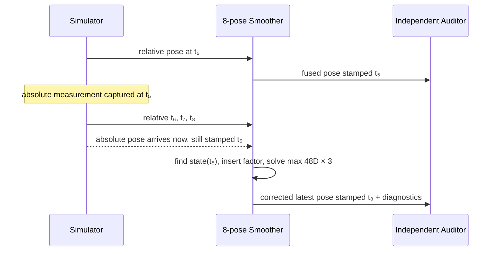

# 2026-10-20 — ROS 2 자세 계약과 Bounded 지연 Factor Smoothing

## 오늘의 핵심 요약

- **기초 실무:** `geometry_msgs/PoseWithCovarianceStamped`의 `header.stamp`, `frame_id`, 쿼터니언, 6×6 row-major 공분산 계약을 정확히 읽는다.
- **심화/RT:** 동적 factor 입력을 최대 8 poses·48 variables·3 iterations로 제한하고, 고정 배열과 single-thread executor로 계산량과 동시 쓰기를 제한한다.
- **알고리즘:** relative visual pose와 늦게 도착하는 absolute pose를 fixed-lag least-squares graph에 같은 **측정 시각**으로 삽입한다.
- **정직한 경계:** 코드는 iSAM2 자체가 아니라, iSAM2의 “새 factor가 영향 주는 부분만 다시 푼다”는 동기를 학습하는 작은 dense tangent-space smoother다.

## 학습 순서 (Reading Order)

1. 이 README의 메시지 계약과 구조도를 읽는다.
2. [`src/pose_factor_simulator.cpp`](src/pose_factor_simulator.cpp)에서 측정시각을 보존한 3-tick 지연을 확인한다.
3. [`src/bounded_pose_smoother.cpp`](src/bounded_pose_smoother.cpp)에서 fixed window, normal equation, 부분 피벗 해법을 수식과 연결한다.
4. [`src/fusion_auditor.cpp`](src/fusion_auditor.cpp)에서 estimator와 독립된 exact-stamp 검증 조건을 확인한다.
5. [`paper_review.md`](paper_review.md)에서 iSAM2의 Bayes tree가 오늘의 dense 예제와 어떻게 다른지 읽는다.
6. 빌드와 smoke test를 실행하고 `/fusion/stats`의 상한·drop·failure 필드를 관찰한다.

## 시스템 아키텍처

```mermaid
graph TD
    S[pose_factor_simulator<br/>10 Hz synthetic 6-DoF motion]
    T[/sim/truth_pose<br/>PoseStamped · map · measurement stamp]
    R[/sim/relative_pose<br/>PoseWithCovarianceStamped · base_previous]
    A[/sim/absolute_pose<br/>PoseWithCovarianceStamped · map<br/>3-tick delayed, original stamp]
    E[bounded_pose_smoother<br/>8 poses · max 48D<br/>3 fixed iterations]
    P[/fusion/pose<br/>PoseWithCovarianceStamped · map]
    D[/fusion/stats<br/>FusionStats · bounded diagnostics]
    U[fusion_auditor<br/>96-slot truth ring<br/>exact-stamp matching]
    Q[/study/pass<br/>Bool · transient_local]

    S --> T --> U
    S --> R --> E
    S --> A --> E
    E --> P --> U
    E --> D --> U
    U --> Q
```

지연 factor가 처리되는 시간 흐름은 다음과 같다.



## 1. 기초 실무 — 자세·시각·공분산 계약

### `PoseWithCovarianceStamped`를 읽는 순서

1. `header.stamp`: callback 도착시각이 아니라 **측정이 유효한 시각**이다. 지연 측정도 이 값을 바꾸지 않는다.
2. `header.frame_id`: pose를 표현한 좌표계다. 절대자세와 출력은 `map`, relative pose는 교육용 계약인 `base_previous`다.
3. `pose.pose.orientation`: ROS 쿼터니언 필드 순서는 `(x,y,z,w)`다. 입력은 사용 전에 정규화한다.
4. `pose.covariance`: `[x,y,z,roll,pitch,yaw]` 순서의 6×6 row-major 행렬이다. diagonal index는 `0,7,14,21,28,35`다.

> `PoseWithCovarianceStamped`는 본래 절대/상대 의미를 스스로 구분하지 않는다. 생산자와 소비자가 topic, frame, 문서로 의미를 합의해야 한다. 제품에서는 relative factor 전용 custom message나 `nav_msgs/Odometry` 계약도 검토한다.

### QoS 선택

실습은 `KeepLast(20) + reliable`을 사용한다. 모든 factor를 재현 가능하게 보는 학습 목적에는 맞지만, 실제 고속 카메라 frontend에서는 지연된 샘플을 쌓는 것보다 best-effort/latest 정책이 나을 수 있다. QoS는 “센서니까 무조건 SensorDataQoS”가 아니라 허용 손실, latency budget, backpressure를 기준으로 결정한다.

## 2. 심화/RT — 계산량이 보이는 실행 경계

| 항목 | 이 실습의 상한 | 이유 |
|---|---:|---|
| active pose states | 8 | 오래된 state를 무한 보존하지 않음 |
| state 자유도 | 6 | `[x,y,z,roll,pitch,yaw]` local tangent 근사 |
| 선형계 차원 | 48 | 배열 크기와 elimination 상한 고정 |
| 반복 횟수 | 3 | 데이터에 따라 while-loop가 늘어나지 않음 |
| pending absolute factors | 8 | burst도 메모리 상한 안에서 처리 |
| truth audit ring | 96 | 검증용 힙 증가 방지 |

`SingleThreadedExecutor`를 쓰므로 relative/absolute callback이 같은 state 배열을 동시에 수정하지 않는다. 그러나 이는 **hard real-time 보장**이 아니다. DDS 수신, message copy, publish, OS scheduling에는 가변 지연이 남는다. 제품 RT 경로에서는 수신/직렬화 경계와 numerical kernel을 더 명확히 분리하고, PREEMPT_RT 우선순위·page fault·WCET를 별도로 검증해야 한다.

### Fixed-lag 밖의 지연 factor

가장 오래된 state보다 과거인 측정은 `too_old_factors_dropped`로 버린다. 이 정책은 정확도 손실을 숨기지 않고 **자원 예산 위반을 관측 가능한 상태**로 만든다. 제품에서는 drop, batch reprocess, larger lag, delayed-state filter 중 요구사항에 맞는 정책을 고른다.

## 3. 알고리즘 — Factor와 Normal Equation

local 6-vector pose를 `x_i`, relative factor를 `zᵣ`, absolute factor를 `zₐ`라 두면 오늘의 잔차는 다음과 같다.

\[
r_r = (x_i - x_{i-1}) - z_r, \qquad
r_a = x_i - z_a
\]

가중 least squares는 다음 비용을 최소화한다.

\[
\min_x \sum \|r_r\|^2_{\Omega_r} + \sum \|r_a\|^2_{\Omega_a}
\]

각 반복에서 코드가 만드는 normal equation은 다음과 같다.

\[
H = J^T \Omega J, \qquad b = J^T \Omega r, \qquad H\Delta x = -b
\]

relative factor의 Jacobian은 `[-I, I]`이므로 이전/현재 diagonal block에는 `+Ω`, 두 cross block에는 `-Ω`가 들어간다. [`bounded_pose_smoother.cpp`](src/bounded_pose_smoother.cpp)의 `build_normal_equations()`가 이 식을 그대로 구현한다.

### 중요한 모델 한계

- translation은 factor를 받을 때 이전 자세의 회전으로 world frame에 옮긴 뒤 해당 창 안에서 고정한다.
- orientation은 Euler local increment다. 큰 회전, pitch ±90° 부근, 강한 비선형 문제에는 맞지 않는다.
- 창을 밀 때 Schur complement의 교차상관 대신 새 첫 state에 Gaussian prior를 둔다.
- dense 48×48 Gaussian elimination이므로 iSAM2의 Bayes tree, sparse re-elimination, fluid relinearization을 구현하지 않는다.
- 출력 covariance는 full `H⁻¹`이 아니라 `1/H_ii` diagonal 근사다.

이 제한을 이해한 뒤 GTSAM의 `ISAM2`, manifold `Pose3`, robust loss, ordering, marginal covariance로 넘어가는 것이 오늘의 핵심이다.

## 빌드와 실행

ROS 2 Jazzy 환경에서 저장소 루트를 `/ws/src/RoboticsStudy`로 둔 예시다.

```bash
cd /ws
colcon build --packages-select daily_robotics_2026_10_20 --event-handlers console_direct+
source install/setup.bash
ROS_DOMAIN_ID=173 ros2 launch daily_robotics_2026_10_20 study.launch.py
```

별도 터미널에서:

```bash
source /ws/install/setup.bash
ROS_DOMAIN_ID=173 ros2 topic echo /fusion/stats
ROS_DOMAIN_ID=173 ros2 topic echo --once /study/pass
```

자동 smoke test:

```bash
source /ws/install/setup.bash
ROS_DOMAIN_ID=173 ros2 run daily_robotics_2026_10_20 smoke_test.sh
```

## 검증 결과

- 정적 검사: package XML parse, launch Python AST, Bash syntax, required files, trailing whitespace, generated-directory 제외가 통과했다.
- 공식 `ros:jazzy-ros-base`, GCC 13.3, Fast DDS 환경에서 `colcon build`가 compiler warning 없이 통과했다.
- ROS domain 173과 174에서 통합 smoke test를 각각 통과했다.
- domain 174의 80개 exact-stamp 표본: position RMSE `0.035010 m`, orientation RMSE `0.012096 rad`, 최대 position error `0.106307 m`, 최대 orientation error `0.020124 rad`.
- 3-tick 지연 factor 15개를 과거 state에 삽입했고, too-old drop `0`, solve failure `0`, 관측된 최대 48D×3 solver 시간은 `166.889 µs`였다.
- 위 시간은 Docker에서 얻은 관측치이며 WCET 또는 hard-RT 증명이 아니다.
- Archify HTML은 showcase 9/9, 오류·경고 0으로 결정적 전달 검증을 통과했다. 자동 브라우저 증거 수집은 Chrome load-event timeout으로 실패하여 perceptual visual review는 완료하지 못했다.

## 파일 지도

| 파일 | 역할 |
|---|---|
| `src/pose_factor_simulator.cpp` | truth, relative pose, 3-tick delayed absolute pose 생성 |
| `src/bounded_pose_smoother.cpp` | 고정 창 factor 삽입, 48D normal equation, 진단 발행 |
| `src/fusion_auditor.cpp` | estimator와 독립된 exact-stamp 정확도·구조 audit |
| `msg/FusionStats.msg` | 계산 상한, 지연 삽입, drop, failure, 실행시간 계약 |
| `test/smoke_test.sh` | `/study/pass == true`를 기다리는 통합 smoke test |
| `paper_review.md` | iSAM2 논문을 오늘 코드와 비교한 리뷰 |

## 레퍼런스

- [ROS 2 Jazzy — PoseWithCovarianceStamped](https://docs.ros.org/en/jazzy/p/geometry_msgs/msg/PoseWithCovarianceStamped.html)
- [ROS 2 Jazzy — PoseWithCovariance](https://docs.ros.org/en/jazzy/p/geometry_msgs/msg/PoseWithCovariance.html)
- [ROS 2 Jazzy — Executors](https://docs.ros.org/en/jazzy/Concepts/Intermediate/About-Executors.html)
- [ROS 2 Jazzy — QoS settings](https://docs.ros.org/en/jazzy/Concepts/Intermediate/About-Quality-of-Service-Settings.html)
- [Kaess et al., iSAM2 author manuscript (MIT DSpace)](https://hdl.handle.net/1721.1/78894)
- [GTSAM ISAM2 documentation](https://borglab.github.io/gtsam/isam2/)
