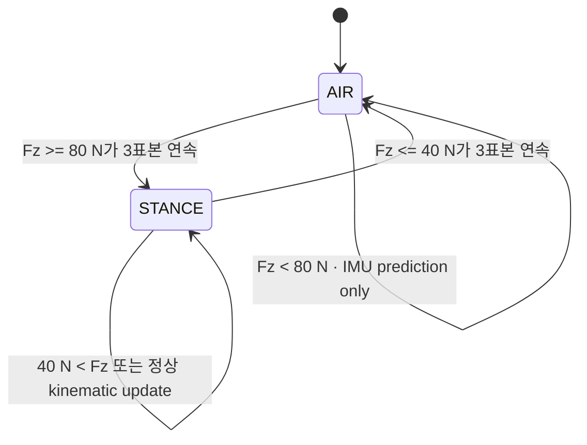

# 2026-10-21 — ROS 2 접촉 계약과 Bounded Contact-Aided EKF

## 오늘의 핵심 요약

- **기초 실무:** `JointState`, `WrenchStamped`, `Imu`의 stamp·frame·단위·배열 계약과 중력 제거 경계를 읽는다.
- **심화/RT:** ROS message를 고정 크기 sample로 축소해 32-slot SPSC로 넘기고, 200 Hz callback이 한 번에 최대 4개만 처리한다.
- **알고리즘:** 힘 hysteresis로 stance/swing을 판정하고, stance에서만 다리 FK/Jacobian 측정을 3-state 수직 EKF에 넣는다.
- **고장 주입:** 100 ms encoder/kinematic outlier를 NIS gate가 거부하는지 독립 auditor가 확인한다.
- **정직한 경계:** 이 예제는 1D 교육용 EKF다. Bloesch 등의 3D observability-constrained EKF나 InEKF를 구현하지 않는다.

## 학습 순서 (Reading Order)

1. 이 README의 메시지 계약과 두 구조도를 읽는다.
2. [`src/contact_sensor_simulator.cpp`](src/contact_sensor_simulator.cpp)에서 `z=L cos(q)`와 IMU specific force를 확인한다.
3. [`src/bounded_contact_ekf.cpp`](src/bounded_contact_ekf.cpp)에서 SPSC, contact FSM, prediction/Joseph update를 수식과 연결한다.
4. [`src/contact_estimator_auditor.cpp`](src/contact_estimator_auditor.cpp)에서 동일 timestamp의 truth/estimate를 독립 검증하는 조건을 본다.
5. [`paper_review.md`](paper_review.md)에서 원 논문의 foothold state와 observability consistency가 왜 필요한지 읽는다.
6. 빌드와 smoke test를 실행하고 `/estimator/stats`의 transition, reject, drop, batch 상한을 관찰한다.

## 시스템 아키텍처

```mermaid
graph TD
    S[contact_sensor_simulator<br/>200 Hz vertical gait + fault injection]
    J[/leg/joint_states<br/>JointState · SensorDataQoS]
    W[/foot/wrench<br/>WrenchStamped · foot_sensor]
    I[/imu/data<br/>Imu · imu_link · specific force]
    C[/contact/sample<br/>synchronized + gravity-compensated]
    T[/sim/truth_pose<br/>PoseStamped · map]
    P[input callback<br/>validate + scalar extraction]
    Q[32-slot SPSC<br/>release/acquire]
    E[200 Hz estimator callback<br/>max 4 samples/cycle<br/>contact FSM + 3-state EKF]
    O[/estimator/pose<br/>PoseWithCovarianceStamped]
    D[/estimator/stats<br/>EstimatorStats]
    A[contact_estimator_auditor<br/>128-slot exact-stamp rings]
    R[/study/pass<br/>Bool · transient_local]

    S --> J
    S --> W
    S --> I
    S --> C --> P --> Q --> E
    S --> T --> A
    E --> O --> A
    E --> D --> A
    A --> R
```

`JointState`, `WrenchStamped`, `Imu`는 표준 도구에서 계약을 관찰하기 위한 원본 토픽이다. 오늘 시뮬레이터는 같은 tick의 값을 이미 동기화하고 IMU 중력을 제거한 `ContactSample`도 함께 만든다. 실제 로봇에서는 hardware timestamp, clock synchronization, TF, `message_filters` 또는 driver-level packetization을 가진 별도 adapter가 이 경계를 담당해야 한다.

접촉 상태는 다음 유한 상태 기계로 바뀐다.



안전을 위해 `Fz <= 40 N` 첫 표본부터 kinematic constraint는 즉시 끄며, 세 표본 dwell은 상태 전이 확정에만 사용한다.

## 1. 기초 실무 — 센서 메시지 계약

### `sensor_msgs/JointState`

- `header.stamp`는 callback 수신 시각이 아니라 관절 값이 함께 유효한 측정 시각이다.
- `name[i]`, `position[i]`, `velocity[i]`, `effort[i]`의 같은 index는 같은 관절을 가리킨다.
- position은 rad, velocity는 rad/s, effort는 회전 관절에서 N·m를 쓴다.
- 배열 크기와 이름을 검증하지 않고 `position[0]`을 읽으면 malformed message나 joint ordering 변경에 취약하다.

### `geometry_msgs/WrenchStamped`

`wrench.force`와 `wrench.torque`는 반드시 `header.frame_id`가 나타내는 좌표계에서 해석한다. 오늘 `foot_sensor`의 +z가 지면 법선이며 `force.z`를 contact 판정에 쓴다. 실제 force/torque sensor는 bias, saturation, cross-axis coupling, 센서 장착 변환을 먼저 보정해야 한다.

### `sensor_msgs/Imu`

가속도계는 단순한 월드 선형가속도가 아니라 specific force를 측정한다. +z-up으로 정지한 센서는 대략 `+9.80665 m/s²`를 읽는다. 오늘 원본 `/imu/data`는 이 값을 보이고, `/contact/sample`은 adapter가 자세와 중력 벡터를 알고 제거했다고 가정한다. `orientation_covariance[0] = -1`은 orientation estimate가 제공되지 않는다는 ROS 계약이다.

### stamp와 동기화

세 토픽의 stamp가 같다는 사실과 callback 도착 순서가 같다는 사실은 다르다. DDS는 서로 다른 topic 사이의 전역 순서를 보장하지 않는다. 오늘 custom sample은 이 문제를 시뮬레이터 안에서 닫지만, 제품에서는 최대 허용 skew, late/drop 정책, clock jump 처리를 인터페이스에 포함해야 한다.

## 2. 심화/RT — 동적 ROS 경계와 고정 커널 분리

| 항목 | 오늘의 상한/정책 | 관측 실패 신호 |
|---|---:|---|
| SPSC storage | 32 slots, 실제 usable 31 | `queue_drops` |
| estimator batch | callback당 최대 4 samples | `max_samples_per_cycle` |
| contact dwell | ON/OFF 각각 3 samples | `contact_transitions` |
| EKF state/matrix | 3 states, 3×3 fixed arrays | compile-time size |
| measurement gate | 2D NIS ≤ 9.21 | `rejected_updates` |
| auditor matching | truth/estimate ring 각 128 slots | exact stamp count |

입력 callback과 estimator timer는 서로 다른 `MutuallyExclusive` callback group에 있고 `MultiThreadedExecutor(2)`에서 돈다. producer는 `head`, consumer는 `tail`만 쓰며 payload 공개는 `release/acquire` 순서를 사용한다. 큐가 차면 기다리거나 heap을 키우지 않고 drop count를 올린다.

이 설계도 hard real-time 보장은 아니다. DDS take/deserialize, ROS publish, executor wake-up, OS scheduling, page fault는 가변 시간이 남는다. `max_cycle_time_us`는 Docker에서 본 표본 최대값일 뿐 WCET가 아니다. 제품 적용 전 PREEMPT_RT, thread affinity/priority, memory locking, tracing, 장시간 worst-case 부하 시험이 필요하다.

## 3. 알고리즘 — 접촉 보조 수직 EKF

상태는 몸체 높이, 수직 속도, 가속도 bias다.

\[
x = [z,\; v_z,\; b_a]^T
\]

중력 제거된 IMU 입력 `a_m`에 대해 prediction은 다음과 같다.

\[
z_{k+1}=z_k+v_k\Delta t+\frac{1}{2}(a_m-b_a)\Delta t^2
\]

\[
v_{k+1}=v_k+(a_m-b_a)\Delta t, \qquad b_{a,k+1}=b_{a,k}
\]

stance에서 발이 미끄러지지 않고 지면에 고정됐다고 가정하면 한 링크 다리의 encoder가 높이와 속도를 준다.

\[
z_m=L\cos q, \qquad v_{z,m}=-L\sin q\,\dot q
\]

코드는 `P'=FPF^T+Q`로 예측한 뒤, height와 velocity를 scalar update 두 번으로 보정한다. 공분산은 수치적으로 더 안전한 Joseph form을 쓴다.

\[
P=(I-KH)P(I-KH)^T+KRK^T
\]

### NIS gate

두 residual을 예상 innovation variance로 나눈 합이 `9.21`보다 크면 측정을 거부한다.

\[
\mathrm{NIS}=\frac{r_z^2}{P_{zz}+R_z}+\frac{r_v^2}{P_{vv}+R_v}
\]

이는 2자유도 chi-square 약 99% 경계를 빌린 간단한 gate다. 실제 residual은 상관될 수 있으므로 제품에서는 full innovation covariance `S=HPH^T+R`와 `r^T S^{-1}r`를 사용해야 한다. NIS gate는 slip detector를 완전히 대체하지 않으며, 계속 거부되는 센서를 health state로 승격해야 한다.

### 중요한 모델 한계

- 1D 한 링크 모델이며 몸체 roll/pitch/yaw, 여러 발, 3D foothold state가 없다.
- stance에서 발이 월드에 고정됐다고 가정하므로 compliant terrain과 slip에서 모델이 깨진다.
- contact는 이진 hysteresis다. 부분 접촉과 방향별 불확실성에는 연속 covariance가 더 적합하다.
- `ContactSample` 생성이 실제 multi-topic synchronization과 TF 변환을 구현하지 않는다.
- 관측가능성을 보존하는 선형화나 invariant error를 쓰지 않는다.

## 빌드와 실행

ROS 2 Jazzy 환경에서 저장소 루트를 `/ws/src/RoboticsStudy`로 둔 예시다.

```bash
cd /ws
colcon build --packages-select daily_robotics_2026_10_21 --event-handlers console_direct+
source install/setup.bash
ROS_DOMAIN_ID=175 ros2 launch daily_robotics_2026_10_21 study.launch.py
```

별도 터미널에서:

```bash
source /ws/install/setup.bash
ROS_DOMAIN_ID=175 ros2 topic echo /leg/joint_states
ROS_DOMAIN_ID=175 ros2 topic echo /foot/wrench
ROS_DOMAIN_ID=175 ros2 topic echo /estimator/stats
```

자동 smoke test:

```bash
source /ws/install/setup.bash
ROS_DOMAIN_ID=175 ros2 run daily_robotics_2026_10_21 smoke_test.sh
```

## 검증 결과

- 정적 검사: package XML parse, launch Python AST, Bash syntax, required-file/generated-directory, trailing whitespace 검사가 통과했다.
- 공식 `ros:jazzy-ros-base`, GCC 13.3, Fast DDS 환경에서 custom message와 세 C++17 executable의 `colcon build`가 compiler warning 없이 통과했다.
- ROS domain 175와 176에서 독립 통합 smoke test가 모두 통과했다.
- domain 175의 600개 exact-stamp 표본: 높이 RMSE `0.001289 m`, 최대 오차 `0.019625 m`, 접촉 전이 7회, accepted update 344회, 의도한 outlier reject 20회, queue drop/invalid 0, 최대 batch 1, 추정 bias `0.045430 m/s²`, 관측 최대 cycle `10.986 µs`.
- domain 176의 600개 exact-stamp 표본: 높이 RMSE `0.000541 m`, 최대 오차 `0.002824 m`, 접촉 전이 7회, accepted update 391회, outlier reject 20회, queue drop/invalid 0, 최대 batch 2, 추정 bias `0.045923 m/s²`, 관측 최대 cycle `15.426 µs`.
- 수치는 결정론적 synthetic vertical model과 Docker에서 얻은 관측치이며 실제 보행 로봇 정확도, WCET 또는 hard-RT 증명이 아니다.

## 파일 지도

| 파일 | 역할 |
|---|---|
| `src/contact_sensor_simulator.cpp` | 표준 센서 계약, 접촉 전이, encoder outlier 생성 |
| `src/bounded_contact_ekf.cpp` | fixed SPSC, hysteresis, 3-state EKF, NIS gate |
| `src/contact_estimator_auditor.cpp` | exact-stamp RMSE·전이·reject·resource 상한 독립 감사 |
| `msg/ContactSample.msg` | 동기화·중력 제거 후 RT 입력 경계 |
| `msg/EstimatorStats.msg` | estimator 수치/자원 진단 계약 |
| `test/smoke_test.sh` | `/study/pass == true`를 기다리는 통합 시험 |
| `paper_review.md` | Bloesch et al. RSS 2012 논문과 오늘 코드의 차이 |

## 레퍼런스

- [ROS 2 Jazzy — `sensor_msgs/JointState`](https://docs.ros.org/en/jazzy/p/sensor_msgs/msg/JointState.html)
- [ROS 2 Jazzy — `sensor_msgs/Imu`](https://docs.ros.org/en/jazzy/p/sensor_msgs/msg/Imu.html)
- [ROS 2 Jazzy — `geometry_msgs/WrenchStamped`](https://docs.ros.org/en/jazzy/p/geometry_msgs/msg/WrenchStamped.html)
- [ROS 2 Jazzy — Executors](https://docs.ros.org/en/jazzy/Concepts/Intermediate/About-Executors.html)
- [ROS 2 Jazzy — QoS settings](https://docs.ros.org/en/jazzy/Concepts/Intermediate/About-Quality-of-Service-Settings.html)
- [Bloesch et al., RSS 2012 proceedings](https://www.roboticsproceedings.org/rss08/p03.html)
- [Bloesch et al., paper PDF](https://www.roboticsproceedings.org/rss08/p03.pdf)
