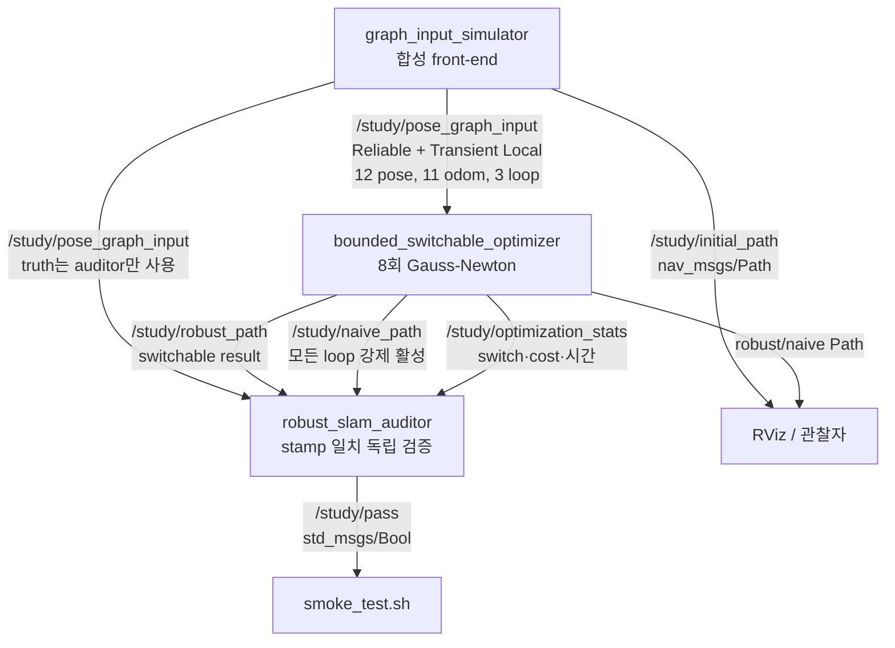
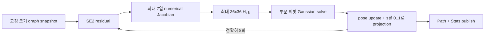

# 2026-10-22 — Bounded Switchable-Constraint Pose Graph SLAM

> **오늘의 핵심:** ROS 2 `Header`/`nav_msgs/Path` snapshot 계약을 익히고, 최대 12 pose·3 loop·36변수로 제한한 Gauss–Newton back-end에서 loop마다 연속 switch를 함께 최적화한다. 정상 loop는 `s≈1`로 유지하고 false positive는 `s≈0`으로 꺼서, 잘못된 장소 인식 하나가 지도 전체를 접는 문제를 막는다.

## 학습 순서 (Reading Order)

1. 이 문서의 **통신 구조**와 **메시지 계약**을 읽는다.
2. `msg/PoseGraphInput.msg`에서 동적 컨테이너 대신 고정 배열로 graph snapshot 경계를 만든 이유를 확인한다.
3. `src/graph_input_simulator.cpp`에서 `T_i^{-1}T_j` 상대 pose와 drift/false-loop 주입을 따라간다.
4. `src/bounded_switchable_optimizer.cpp`의 residual → Jacobian → normal equation → 부분 피벗 풀이 → switch projection 순서를 읽는다.
5. `src/robust_slam_auditor.cpp`에서 토픽 도착 순서가 아니라 `Header.stamp`로 결과를 결합하고 독립 RMSE를 계산하는 법을 본다.
6. `paper_review.md`에서 원 논문의 문제·수학적 직관·실무 한계를 정리한다.

## 오늘의 세 영역

| 영역 | 학습 내용 | 코드에서 확인할 곳 |
|---|---|---|
| 기초 실무 | `Header.stamp/frame_id`, `nav_msgs/Path`, `PoseStamped`, Reliable + Transient Local snapshot QoS, yaw↔quaternion | simulator, launch, custom messages |
| 심화·RT | 최대 12 pose/3 loop/36변수, `std::array`, 8회 iteration, 최대 7개 local Jacobian 열, 동적 할당 없는 numerical kernel, 단일 callback state ownership | optimizer |
| 알고리즘 | SE(2) pose graph, gauge 고정, Gauss–Newton, switchable loop constraint와 prior, false-loop rejection | optimizer, auditor |

## 통신 구조



Optimizer 내부의 bounded 경로는 다음과 같다.



## 메시지와 좌표계 계약

- 모든 pose는 `map` 프레임에서 표현하며 한 snapshot의 입력·출력은 같은 `Header.stamp`를 쓴다.
- `nav_msgs/Path.header`와 각 `PoseStamped.header`도 동일하게 맞춘다. RViz가 그리는 선만 맞는다고 데이터 계약까지 맞는 것은 아니다.
- 평면 yaw `θ`는 `q=[0, 0, sin(θ/2), cos(θ/2)]`로 직렬화한다.
- `PoseGraphInput`의 `truth_*`는 교육용 auditor 전용이다. optimizer가 사용하면 ground truth 누설이다.
- snapshot은 마지막 완전본 하나만 의미하므로 `KeepLast(1) + Reliable + Transient Local`을 쓴다. 이벤트 스트림이라면 같은 QoS 결정을 그대로 복사하면 안 된다.

## 수식과 코드 연결

pose `i`에서 본 `j`의 예측 상대 위치는

\[
\hat{z}_{ij}^{xy}=
\begin{bmatrix}
\cos\theta_i & \sin\theta_i\\
-\sin\theta_i & \cos\theta_i
\end{bmatrix}
(p_j-p_i)
\]

이고 yaw residual은 `wrap((θ_j-θ_i)-Δθ_ij)`다. 코드는 `edge_residual()`에서 이 식을 그대로 계산한다.

오늘의 robust 목적함수는 다음 교육용 형태다.

\[
\min_{X,S}\sum_{e\in O}\lVert r_e(X)\rVert_{\Omega_o}^2
+\sum_{k\in L}\lVert s_k r_k(X)\rVert_{\Omega_l}^2
+\lambda\sum_{k\in L}(1-s_k)^2,\qquad 0\le s_k\le1
\]

- 첫 항: odometry chain은 항상 유지한다.
- 둘째 항: loop residual은 switch `s_k`가 0이면 영향이 사라진다.
- 셋째 항: 정상 loop를 함부로 끄지 못하게 `s=1` prior를 둔다.
- 첫 pose를 변수에서 제외해 global translation/yaw gauge freedom을 제거한다.
- 매 iteration에 `HΔ=-g`를 풀고, pose step과 switch step을 제한한 뒤 switch를 `[0,1]`로 projection한다.

## 실행

ROS 2 Jazzy 환경에서 저장소 루트를 workspace로 사용할 때:

```bash
source /opt/ros/jazzy/setup.bash
colcon build \
  --base-paths daily_robotics/2026-10-22 \
  --packages-select daily_robotics_2026_10_22
source install/setup.bash
ros2 launch daily_robotics_2026_10_22 study.launch.py
```

별도 터미널에서:

```bash
source /opt/ros/jazzy/setup.bash
source install/setup.bash
ros2 topic echo /study/optimization_stats
ros2 topic echo /study/pass
```

자동 검증:

```bash
ROS_DOMAIN_ID=177 daily_robotics/2026-10-22/test/smoke_test.sh
```

## 검증 결과

- 공식 `ros:jazzy-ros-base` 이미지, GCC 13.3, Fast DDS에서 custom message와 세 C++17 실행 파일이 compiler warning 없이 `colcon build`되었다.
- ROS domain 177~180의 네 번 독립 실행이 모두 통과했다. 각 실행은 서로 다른 sequence 세 개를 연속 검증했다.
- 위치 RMSE: switchable `0.036774 m`, 모든 loop를 믿는 naive 기준선 `1.382048 m`.
- 정상 loop 최소 switch `0.9995`, 주입한 false loop switch `0.0018`.
- naive와 robust 두 solver를 합친 관측 callback 시간은 `1,364.820~1,833.540 µs`였다.
- 이는 Docker 합성 입력의 관측값이지 WCET, hard-real-time 보장, 실제 센서 강건성의 증명이 아니다.

## 실무 체크리스트

- loop candidate를 back-end에 넣기 전 geometric verification, temporal consistency, semantic filtering을 수행한다.
- switch가 낮아졌다는 사실을 조용히 버리지 말고 loop ID·residual·switch·장소 인식 점수를 진단 토픽/로그에 남긴다.
- `λ`와 information matrix를 함께 calibration한다. prior가 너무 강하면 false loop를 못 끄고, 너무 약하면 정상 loop까지 꺼진다.
- 큰 graph에서는 이 예제의 dense `36x36` 풀이를 쓰지 말고 sparse block solver, incremental relinearization, graph-size/latency budget을 사용한다.
- mapping 결과와 별도로 충돌 회피·geofence·속도 제한 같은 독립 안전 계층을 둔다.

## 참고 자료

- [ROS 2 Jazzy `nav_msgs/Path` 메시지](https://docs.ros.org/en/jazzy/p/nav_msgs/msg/Path.html)
- [ROS 2 QoS 개념](https://docs.ros.org/en/jazzy/Concepts/Intermediate/About-Quality-of-Service-Settings.html)
- [ROS 2 Jazzy `rclcpp::QoS`](https://docs.ros.org/en/jazzy/p/rclcpp/generated/classrclcpp_1_1QoS.html)
- [Sünderhauf & Protzel, Switchable Constraints for Robust Pose Graph SLAM, IROS 2012](https://doi.org/10.1109/IROS.2012.6385590)
- [저자 공개 논문 PDF](https://nikosuenderhauf.github.io/assets/papers/IROS12-switchableConstraints.pdf)
- [Graph-Based SLAM 튜토리얼](https://doi.org/10.1109/MITS.2010.939925)
