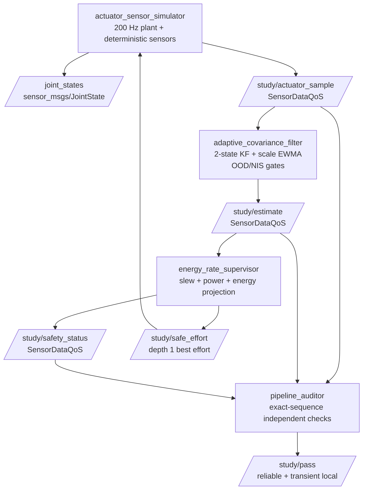
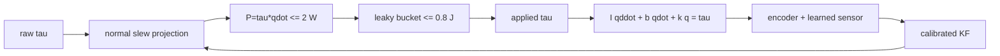

# 2026-10-23 — Learned 공분산 보정과 Actuator 에너지 안전 감독

오늘은 **ROS 2 `JointState`의 측정 계약**, **고정 계산량을 갖는 토크 rate/power/energy supervisor**, **learned measurement 공분산을 NIS로 보정하고 OOD에서 거부하는 2-state Kalman filter**를 하나의 폐루프로 연결한다. 핵심은 “추정값이 정확해 보이는가?”와 “그 추정 불확실성을 믿어도 되는가?”, “그 값으로 만든 명령이 물리적 안전 envelope 안에 있는가?”를 각각 독립적으로 검사하는 것이다.

> 이 패키지는 안전 설계를 배우기 위한 합성 실습이다. Docker에서 관찰한 callback 시간은 WCET가 아니며, 이 코드를 그대로 실제 actuator safety function이나 인증 근거로 사용하면 안 된다.

## 학습 순서 (Reading Order)

1. 이 문서의 메시지 계약과 구조도를 읽고 네 노드의 책임 경계를 잡는다.
2. [`actuator_sensor_simulator.cpp`](src/actuator_sensor_simulator.cpp)에서 `JointState` 배열 대응, 측정 timestamp, 단일 관절 동역학을 확인한다.
3. [`adaptive_covariance_filter.cpp`](src/adaptive_covariance_filter.cpp)에서 2-state KF, Joseph covariance update, NIS, 공분산 scale EWMA, OOD gate를 수식과 대조한다.
4. [`energy_rate_supervisor.cpp`](src/energy_rate_supervisor.cpp)에서 torque slew, `P=tau*q_dot`, leaky energy bucket의 적용 순서를 추적한다.
5. [`pipeline_auditor.cpp`](src/pipeline_auditor.cpp)에서 sequence 기반 독립 검증과 안전 불변식을 읽는다.
6. [`paper_review.md`](paper_review.md)에서 논문의 offline learned map과 오늘 구현한 online scalar 교육 모델의 차이를 정리한다.

## 오늘의 세 영역

### 1. 기초 실무 — `JointState`와 명령/상태 경계

- `sensor_msgs/msg/JointState`의 `name[i]`, `position[i]`, `velocity[i]`, `effort[i]`는 같은 관절을 나타낸다.
- 회전 관절의 단위는 각각 rad, rad/s, N·m이다. `Header.stamp`는 callback 도착시각이 아니라 측정값이 유효했던 시각이다.
- `/joint_states`는 관측 상태이고 `/study/safe_effort`는 actuator에 적용할 명령이다. 이름이 비슷해도 데이터 방향과 책임이 다르다.
- 합성 learned sensor와 정답은 의미가 분명한 custom message에 넣었다. 제품 코드에서는 truth field를 절대 runtime 입력으로 포함하지 않는다.

### 2. 심화/RT — bounded energy/rate supervisor

200 Hz supervisor의 hot path는 scalar 연산만 수행한다.

1. 정상 torque 변화율을 `|tau_k-tau_(k-1)| <= 40*0.005 = 0.2 N·m`로 제한한다.
2. 양의 기계 출력 `P+ = max(0, tau*q_dot)`을 2 W 이하로 투영한다.
3. `E_k=max(0,E_(k-1)-0.25*dt)+P+*dt`인 leaky bucket을 0.8 J 이하로 유지한다.
4. power/energy 위험을 줄이는 emergency derating은 정상 slew comfort limit보다 우선한다.

ROS/DDS callback, OS scheduling, allocator, 실제 drive의 전류 loop까지 포함한 hard RT 보장은 하지 않는다. 실제 제품에서는 command timeout, STO, drive-side current/thermal limit, 독립 safety MCU도 함께 설계해야 한다.

### 3. 알고리즘 — 공분산 보정 + OOD-aware Kalman filter

상태는 `x=[q, q_dot]^T`, 등속 전이는 다음과 같다.

```text
x_k^- = [[1, dt], [0, 1]] x_(k-1)
P_k^- = F P_(k-1) F^T + Q
```

learned sensor가 보고한 분산 `R_model`을 그대로 쓰지 않고 `R_cal=s*R_model`로 보정한다. innovation `nu=z-Hx^-`와 `S=H P^- H^T+R`에 대해 `NIS=nu^2/S`를 계산한다. 1차원에서 NIS가 계속 1보다 크면 대체로 공분산이 낙관적이라는 신호다. 오늘은 in-domain 표본에 한해 clipped EWMA로 `s`를 갱신한다.

`ood_score>0.8`이면 measurement update를 하지 않는다. OOD score와 NIS gate는 역할이 다르다.

- OOD gate: 입력 분포가 학습 범위를 벗어났다는 model-side 신호
- NIS gate: 현재 동역학 예측과 측정이 통계적으로 맞지 않는다는 estimator-side 신호
- covariance calibration: 받아들일 정상 측정의 가중치를 현실적으로 만드는 작업

## 시스템 아키텍처





## 파일 구성

```text
2026-10-23/
├── CMakeLists.txt
├── package.xml
├── README.md
├── paper_review.md
├── launch/study.launch.py
├── msg/{ActuatorSample,EstimatorOutput,SafetyStatus}.msg
├── src/
│   ├── actuator_sensor_simulator.cpp
│   ├── adaptive_covariance_filter.cpp
│   ├── energy_rate_supervisor.cpp
│   └── pipeline_auditor.cpp
└── test/smoke_test.sh
```

## 빌드와 실행

ROS 2 Jazzy 환경에서 저장소 루트를 workspace로 사용한다.

```bash
colcon build --packages-select daily_robotics_2026_10_23 \
  --cmake-args -DCMAKE_BUILD_TYPE=RelWithDebInfo
source install/setup.bash
ros2 launch daily_robotics_2026_10_23 study.launch.py
```

독립 smoke test:

```bash
source install/setup.bash
ROS_DOMAIN_ID=182 bash daily_robotics/2026-10-23/test/smoke_test.sh
```

관찰할 항목:

```bash
ros2 topic echo /study/estimate
ros2 topic echo /study/safety_status
ros2 topic hz /joint_states
```

## 자체 검증 결과

공식 `ros:jazzy-ros-base` 이미지, GCC 13.3, Fast DDS에서 Release/RelWithDebInfo 두 빌드를 수행했다. custom message 3개와 C++17 실행 파일 4개가 compiler warning 없이 빌드되었고, ROS domain 182와 183에서 통합 smoke test가 각각 PASS했다.

두 번째 1,200 exact-sequence 표본 실행 결과:

- filter 위치 RMSE: `0.010844 rad`
- 정상 learned measurement RMSE: `0.016574 rad`
- 최종 covariance scale: `5.876`
- OOD/NIS 거부: `135/31`, OOD 오수락: `0`
- rate/power/energy 제한 작동 횟수: `995/89/673`
- power/energy envelope 및 정상 rate 위반: `0/0`
- 관찰된 최대 callback 계산시간: filter `23.475 us`, supervisor `67.166 us`

이 수치는 합성 입력과 일반 Docker scheduler에서 얻은 관찰값이며 WCET, deadline 보장, 실제 모터 안전성 증거가 아니다.

## 실패를 읽는 법

- `calibration_scale`이 상한 25에 오래 붙으면 단일 scalar map으로 설명되지 않거나 Q/R/동기화가 틀렸을 수 있다.
- `nis_reject_count`가 정상 구간에서도 급증하면 공분산만 키우지 말고 bias, timestamp, frame, 데이터 연관을 먼저 점검한다.
- `ood_reject_count=0`인데 합성 OOD 구간이 존재하면 model-side OOD detector 계약이 끊긴 것이다.
- `energy_limit_count`가 계속 증가하면 controller 요구가 plant의 지속 에너지 예산과 맞지 않는다. supervisor threshold만 키우는 것은 해결이 아니다.

## 실무 확장 과제

1. offline validation set으로 positive-definite matrix map `P_cal=L L^T`를 학습하고 runtime에는 inference만 수행한다.
2. NIS뿐 아니라 truth가 있을 때 NEES와 1/2/3-sigma coverage를 CI report로 만든다.
3. 1-DoF scalar supervisor를 multi-axis `tau^T q_dot`와 thermal RC model로 확장한다.
4. RT kernel을 DDS callback에서 분리하고 `SCHED_FIFO`, page locking, allocator/trace 검증을 추가한다.
5. emergency derating과 정상 slew limit의 우선순위를 safety requirement와 hazard analysis에 명문화한다.

## 레퍼런스

- [ROS 2 Jazzy documentation](https://docs.ros.org/en/jazzy/)
- [`sensor_msgs/msg/JointState` API](https://docs.ros.org/en/jazzy/p/sensor_msgs/msg/JointState.html)
- [ROS 2 QoS concepts](https://docs.ros.org/en/jazzy/Concepts/Intermediate/About-Quality-of-Service-Settings.html)
- [ICRA 2021 paper: Learned Uncertainty Calibration for Visual Inertial Localization](https://arxiv.org/abs/2110.02136)
- [IEEE DOI: 10.1109/ICRA48506.2021.9561179](https://doi.org/10.1109/ICRA48506.2021.9561179)
