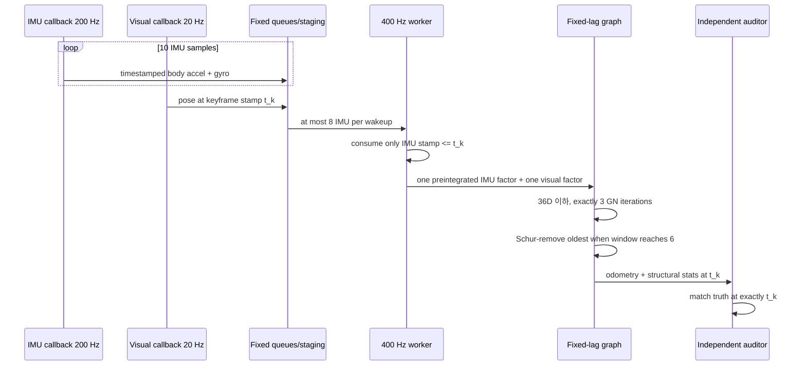

# 2026-10-24 — IMU Preintegration, Bounded Multi-rate Scheduling, Schur Marginalization

## 오늘의 핵심 요약

- **기초 실무:** `sensor_msgs/Imu`, `PoseWithCovarianceStamped`, `nav_msgs/Odometry`의 timestamp·frame·SI 단위·covariance·twist-frame 계약을 연결해서 읽는다.
- **심화/RT:** 200 Hz IMU와 20 Hz visual keyframe을 callback에서 직접 최적화하지 않고, SPSC queue → 32-slot staging → 400 Hz bounded worker로 넘긴다.
- **알고리즘:** IMU 10개를 keyframe 사이의 한 relative factor로 preintegrate하고, 6-state fixed-lag window를 3회 Gauss–Newton으로 푼다.
- **진짜 marginalization:** 가장 오래된 state를 그냥 버리지 않고 Schur complement로 제거해 남은 5 states의 dense Gaussian prior에 정보를 보존한다.
- **정직한 경계:** 코드는 전체 3D `SO(3)`/`SE_2(3)` VIO가 아니라 planar `SO(2)` 축약형이다. manifold preintegration, bias correction, marginalization의 구조를 작게 검증하는 교육 구현이다.

## 학습 순서 (Reading Order)

1. 아래 메시지 계약과 두 구조도를 먼저 읽는다.
2. [`src/vio_sensor_simulator.cpp`](src/vio_sensor_simulator.cpp)에서 200 Hz body-frame IMU와 20 Hz noisy visual keyframe이 같은 clock을 쓰는 방식을 본다.
3. [`src/bounded_preintegration_smoother.cpp`](src/bounded_preintegration_smoother.cpp)의 `SpscRing`, staging, `Preintegrator` 순서로 읽는다.
4. 같은 파일의 `imu_residual()`, `solve_window()`, `marginalize_oldest()`를 아래 수식과 대조한다.
5. [`src/vio_auditor.cpp`](src/vio_auditor.cpp)에서 truth/odometry/stats를 **exact timestamp**로 매칭하는 독립 검증을 확인한다.
6. [`paper_review.md`](paper_review.md)를 읽고 오늘의 planar 구현과 Forster 등의 full 3D 이론을 구분한다.
7. build와 smoke test를 실행한 뒤 `/vio/stats`에서 queue drop, batch, marginalization, pivot, bias, 실행시간을 관찰한다.

## ROS 통신 구조 (`rqt_graph` 관점)

```mermaid
graph TD
    S[vio_sensor_simulator<br/>200 Hz planar dynamics]
    I[/sim/imu<br/>sensor_msgs/Imu · SensorDataQoS<br/>imu_link · m/s² · rad/s]
    V[/sim/visual_pose<br/>PoseWithCovarianceStamped · 20 Hz<br/>map · Reliable]
    T[/sim/truth_pose<br/>PoseStamped · 20 Hz]
    Q1[64-slot IMU SPSC]
    Q2[8-slot visual SPSC]
    W[400 Hz bounded worker<br/>max 8 IMU + 1 visual/cycle]
    P[SO(2) preintegrator<br/>about 10 IMU → 1 factor]
    G[6-state fixed-lag smoother<br/>36 variables · 3 GN iterations]
    M[Schur marginalizer<br/>6D oldest → 30D prior]
    O[/vio/odometry<br/>Odometry · map→base_link]
    D[/vio/stats<br/>PreintegrationStats]
    A[vio_auditor<br/>256-slot exact-stamp rings]
    R[/study/pass<br/>Bool · Transient Local]

    S --> I --> Q1 --> W --> P --> G
    S --> V --> Q2 --> W
    G --> M --> G
    G --> O --> A
    G --> D --> A
    S --> T --> A
    A --> R
```

## 한 keyframe이 처리되는 시간 흐름



## 1. 기초 실무 — 메시지 계약을 먼저 고정한다

### `sensor_msgs/Imu`

- `header.stamp`는 callback 도착시각이 아니라 측정시각이다. 적분의 `dt`는 이 stamp 차이로 계산한다.
- `header.frame_id="imu_link"`이므로 `angular_velocity`와 `linear_acceleration`은 sensor/body frame 값이다.
- 각속도 단위는 `rad/s`, 선형가속도 단위는 `m/s²`다. 오늘 simulator는 중력을 제거한 planar 가속도를 보낸다.
- orientation을 제공하지 않으므로 `orientation_covariance[0] = -1`이다. all-zero quaternion을 유효 자세로 해석하지 않는다.
- covariance가 0이면 “완벽히 정확”이 아니라 종종 “미기입”을 뜻한다. 생산자 계약을 함께 확인해야 한다.

### Visual pose와 output odometry

- `PoseWithCovarianceStamped.pose.covariance`는 `[x,y,z,roll,pitch,yaw]` 순서의 6×6 row-major 배열이다.
- visual pose와 output pose는 `map`에 표현한다.
- `Odometry.header.frame_id="map"`, `child_frame_id="base_link"`다. pose는 map 기준이지만 twist는 child frame 기준이므로 코드에서 `R(yaw)^T v_world`로 회전한다.
- 서로 다른 topic의 도착 순서는 보장되지 않는다. staging은 visual stamp보다 미래인 IMU를 다음 keyframe 구간에 남긴다.

## 2. 심화/RT — 평균 속도보다 경계가 먼저다

| 자원/작업 | 고정 상한 | 초과 시 동작 |
|---|---:|---|
| IMU SPSC payload | 64 samples | `imu_queue_drops` 증가 |
| visual SPSC payload | 8 keyframes | `visual_queue_drops` 증가 |
| worker staging | 32 IMU | `staged_imu_drops` 증가 |
| 한 worker wakeup | IMU 8 + visual 1 | 나머지는 다음 wakeup |
| active graph | 6 states × 6 DoF = 36 variables | oldest를 marginalize |
| GN 반복 | 정확히 3회 | 데이터에 따른 무한 반복 없음 |
| IMU factor Jacobian | 12 columns × central difference | factor당 평가 횟수 고정 |
| auditor ring | topic별 256 entries | 오래된 항목 overwrite |

`MultiThreadedExecutor`와 callback group 분리는 동시 실행 가능성을 만들 뿐 hard real-time을 보장하지 않는다. DDS receive/copy, executor wakeup, OS scheduling, page fault는 여전히 가변이다. `latest_kernel_us`와 `max_kernel_us`는 관측치이지 WCET 증명이 아니다.

SPSC의 acquire/release는 producer가 payload를 모두 쓴 뒤 head를 공개하고, consumer가 head를 확인한 뒤 payload를 읽도록 한다. 이 구조도 다음을 자동 해결하지는 않는다.

- publisher가 여러 개인 MPSC 상황
- callback thread가 바뀌는 reentrant group
- message 자체의 내부 동적 할당
- producer가 consumer보다 지속적으로 빠른 overload

## 3. 알고리즘 — IMU를 keyframe factor로 압축한다

keyframe `i`의 local frame에서 body 가속도와 yaw rate를 적분한다.

\[
\Delta \theta_{k+1}=\Delta \theta_k+(\omega_k-b_g)\Delta t
\]

\[
\Delta v_{k+1}=\Delta v_k+R(\Delta\theta_{k+1/2})a_k\Delta t
\]

\[
\Delta p_{k+1}=\Delta p_k+\Delta v_k\Delta t+\frac{1}{2}R(\Delta\theta_{k+1/2})a_k\Delta t^2
\]

중요한 점은 `Δp, Δv, Δθ`가 world frame이 아니라 **keyframe i의 local frame**에 있다는 것이다. 따라서 optimizer가 `yaw_i`를 바꾸어도 raw IMU 10개를 다시 적분하지 않고 `R(yaw_i)`만 바꾸면 된다.

### 늦은 bias 수정

preintegration 당시 bias reference를 `b̄_g`라 하고 optimizer의 현재 bias를 `b_g`라 하면 다음 1차 근사를 쓴다.

\[
\Delta p(b_g) \approx \Delta p(\bar b_g) + J_{p,b}(b_g-\bar b_g)
\]

`Δv`, `Δθ`도 같다. 오늘 코드는 고정 epsilon으로 두 preintegration을 병렬 수행해 Jacobian을 finite difference로 얻는다. full 3D 제품 구현은 analytic bias Jacobian과 covariance propagation을 사용해야 한다.

### IMU factor residual

state는 `x=[p_x,p_y,v_x,v_y,yaw,b_g]`다.

\[
r_p=R_i^T(p_j-p_i-v_i\Delta t)-\Delta p(b_{g,i})
\]

\[
r_v=R_i^T(v_j-v_i)-\Delta v(b_{g,i}),\quad
r_\theta=\mathrm{wrap}(\theta_j-\theta_i-\Delta\theta(b_{g,i}))
\]

\[
r_b=b_{g,j}-b_{g,i}
\]

visual factor는 `[x,y,yaw]`를 관측한다. 고정 세 번의 Gauss–Newton에서 `H=JᵀΩJ`, `b=JᵀΩr`, `Hδ=-b`를 푼다.

## 4. Schur complement — 정보를 버리지 않고 state를 제거한다

가장 오래된 state `x_o`와 남은 state `x_r`로 normal equation을 나눈다.

\[
\begin{bmatrix}H_{oo}&H_{or}\\H_{ro}&H_{rr}\end{bmatrix}
\begin{bmatrix}\delta_o\\\delta_r\end{bmatrix}
=-
\begin{bmatrix}b_o\\b_r\end{bmatrix}
\]

`x_o`를 제거하면 남은 state에 다음 prior가 생긴다.

\[
H_m=H_{rr}-H_{ro}H_{oo}^{-1}H_{or},\qquad
b_m=b_r-H_{ro}H_{oo}^{-1}b_o
\]

이것이 [`marginalize_oldest()`](src/bounded_preintegration_smoother.cpp)의 계산이다. 오래된 state를 배열에서 지우기 전에 `H_m,b_m`을 저장하므로 과거 visual/IMU 정보가 남는다. 다만 선형화점을 고정한 dense prior이므로 장시간 비선형 운동에서는 inconsistency가 누적될 수 있다.

## 빌드와 실행

ROS 2 Jazzy 환경에서 저장소 루트를 `/ws/src/RoboticsStudy`로 둔 예시다.

```bash
cd /ws
colcon build --packages-select daily_robotics_2026_10_24 --event-handlers console_direct+
source install/setup.bash
ROS_DOMAIN_ID=184 ros2 launch daily_robotics_2026_10_24 study.launch.py
```

별도 터미널에서:

```bash
source /ws/install/setup.bash
ROS_DOMAIN_ID=184 ros2 topic echo /vio/stats
ROS_DOMAIN_ID=184 ros2 topic echo --once /study/pass
```

자동 smoke test:

```bash
source /ws/install/setup.bash
ROS_DOMAIN_ID=184 ros2 run daily_robotics_2026_10_24 smoke_test.sh
```

## 검증 결과

- 정적 검사: package XML parse, launch Python AST, Bash syntax, trailing whitespace, 필수 파일, fixed-capacity hot path를 확인했다.
- 공식 `ros:jazzy-ros-base`, GCC 13.3, Fast DDS에서 RelWithDebInfo와 Release `colcon build`가 compiler warning 없이 통과했다.
- ROS domain 185–189에서 Release 통합 smoke를 5회 연속 통과했다. 120 exact-stamp 표본에서 position RMSE는 `0.012052–0.012079 m`, yaw RMSE는 `0.004236–0.004268 rad`였다.
- 최대 position/yaw error는 각각 `0.016963 m`, `0.006331 rad`; gyro-bias 추정은 `0.014031–0.015650 rad/s`로 실제 `0.015 rad/s`와 가까웠다.
- 각 run은 115–117회 Schur marginalization을 수행했고 solve failure와 queue/staging/stale drop은 0이었다. wakeup당 관측 최대 IMU batch는 1–2, 최소 marginal block pivot은 약 `6.552e2`였다.
- 관측된 최대 numerical-kernel 시간은 Release에서 `50.797–91.298 µs`였다. 첫 RelWithDebInfo warm-up run은 SensorDataQoS 시작 구간에서 IMU가 없는 visual interval 하나를 계측·건너뛰었고 최대 `134.313 µs`를 기록했다. smoke 정책은 이런 시작 구간 1회를 허용하되 queue/staging drop과 solve failure는 허용하지 않는다.
- 위 시간은 해당 Docker 실행의 관측치일 뿐 WCET 또는 hard-RT 증명이 아니다.

## 실패 모드와 제품화 경계

- planar model은 roll/pitch/gravity/3축 accelerometer bias를 추정하지 않는다.
- visual outlier에 robust loss나 RANSAC이 없으므로 잘못된 pose가 graph를 끌 수 있다.
- finite-difference Jacobian은 이해하기 쉽지만 analytic/automatic differentiation보다 느리고 epsilon에 민감하다.
- fixed-lag marginal prior는 오래된 선형화점에 고정된다. FEJ, observability, gauge 처리가 별도 필요하다.
- diagonal measurement weight와 단순 damping은 정교한 IMU covariance propagation을 대신하지 않는다.
- queue가 넘치면 drop을 숨기지 않지만, 실제 안전 동작으로 전환하는 supervisor는 별도 계층이어야 한다.

## 실습 과제

1. `kMaxImuDrainPerCycle`을 1로 낮춰 queue drop과 end-to-end latency가 어떻게 바뀌는지 측정한다.
2. visual yaw covariance를 100배 키워 gyro bias 관측성이 약해지는지 확인한다.
3. finite-difference Jacobian을 analytic Jacobian으로 바꾸고 callback 시간을 비교한다.
4. Huber loss와 visual outlier를 추가하되 반복/메모리 상한을 유지한다.
5. GTSAM `PreintegratedImuMeasurements`/`FixedLagSmoother`로 옮기고 planar 구현과 결과를 대조한다.

## 파일 지도

| 파일 | 역할 |
|---|---|
| `src/vio_sensor_simulator.cpp` | 200 Hz IMU, 20 Hz visual pose/truth 생성 |
| `src/bounded_preintegration_smoother.cpp` | bounded queue, SO(2) preintegration, fixed-lag solve, Schur prior |
| `src/vio_auditor.cpp` | exact-stamp 정확도·drop·상한·bias 독립 audit |
| `msg/PreintegrationStats.msg` | 자원 상한과 수치 상태를 외부 관측 가능한 계약으로 제공 |
| `test/smoke_test.sh` | `/study/pass == true`를 기다리는 통합 smoke test |
| `paper_review.md` | Forster et al. RSS 2015를 엔지니어 관점에서 비판적으로 리뷰 |

## 레퍼런스

- [ROS 2 Jazzy — sensor_msgs/Imu](https://docs.ros.org/en/jazzy/p/sensor_msgs/msg/Imu.html)
- [ROS 2 Jazzy — nav_msgs/Odometry](https://docs.ros.org/en/jazzy/p/nav_msgs/msg/Odometry.html)
- [ROS 2 Jazzy — Executors](https://docs.ros.org/en/jazzy/Concepts/Intermediate/About-Executors.html)
- [ROS 2 Jazzy — QoS settings](https://docs.ros.org/en/jazzy/Concepts/Intermediate/About-Quality-of-Service-Settings.html)
- [Forster et al., RSS 2015 proceedings](https://www.roboticsproceedings.org/rss11/p06.html)
- [Forster et al., arXiv:1512.02363](https://arxiv.org/abs/1512.02363)
- [GTSAM IMU Factor notes](https://docs.ros.org/en/jazzy/p/gtsam/_downloads/a4e7b9092d404f4ce7731702492594a2/ImuFactor.pdf)
