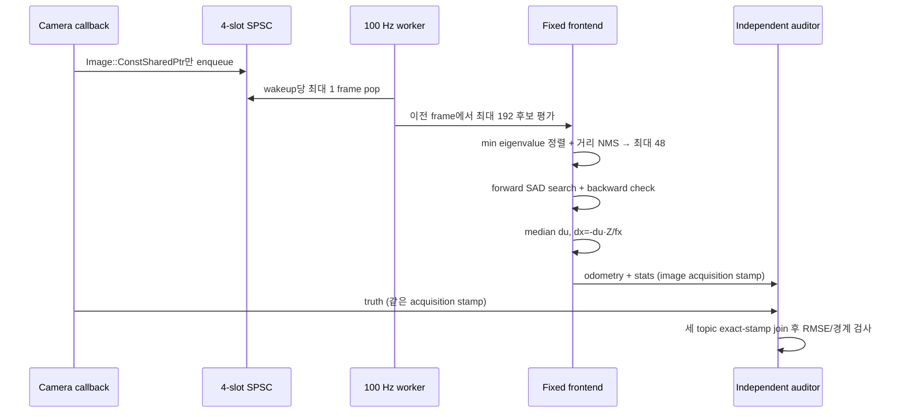

# 2026-10-25 — Camera 계약, Bounded Feature Tracking, Visual SLAM Frontend

## 오늘의 핵심 요약

- **기초 실무:** `sensor_msgs/Image`와 `CameraInfo`의 acquisition timestamp, optical frame, `mono8`, `step`, intrinsic `K/P` 계약을 읽고 검증한다.
- **심화/RT:** image callback은 포인터만 4-slot SPSC queue로 넘기고, 100 Hz worker가 wakeup당 frame 하나만 처리한다. 후보 192개, track 48개, 5×5 patch, ±4 px search로 numerical work를 제한한다.
- **알고리즘/SLAM:** Shi–Tomasi의 작은 고윳값으로 feature를 선택하고, bounded block matching과 forward-backward 검사로 대응점을 만든다. static background flow의 median으로 visual odometry 증분을 얻는다.
- **강건성 실험:** 배경은 `-1 px/frame`, 중앙 동적 patch는 `-3 px/frame`으로 움직인다. 최대 48개 flow의 median이 소수 동적 feature에 흔들리지 않는지 독립 auditor가 확인한다.
- **정직한 경계:** 이 코드는 full KLT, essential matrix, PnP, bundle adjustment, loop closure를 구현한 완전한 SLAM이 아니다. 깊이 4 m를 아는 평면 장면에서 feature frontend의 계약과 bounded scheduling을 검증하는 교육 구현이다.

## 학습 순서 (Reading Order)

1. 아래 ROS 메시지 계약과 두 구조도를 먼저 읽는다.
2. [`src/camera_stream_simulator.cpp`](src/camera_stream_simulator.cpp)에서 pinhole 식이 `-1 px/frame` 영상 이동으로 바뀌는 과정을 본다.
3. [`src/bounded_feature_tracker.cpp`](src/bounded_feature_tracker.cpp)의 `SpscRing`, `select_features()`, `find_best_match()`, `track_selected()` 순서로 읽는다.
4. 아래 Shi–Tomasi 고윳값, SAD, forward-backward, pixel-to-metric 수식을 코드와 대조한다.
5. [`src/visual_frontend_auditor.cpp`](src/visual_frontend_auditor.cpp)에서 topic 도착 순서 대신 acquisition stamp로 세 메시지를 join하는 방식을 확인한다.
6. [`paper_review.md`](paper_review.md)를 읽고 원 논문의 affine KLT monitoring과 오늘의 작은 translation/block-matching 구현을 구분한다.
7. Release build와 smoke test 후 `/visual_frontend/stats`의 feature 수, rejection, flow, drop, 실행시간을 관찰한다.

## ROS 통신 구조 (`rqt_graph` 관점)

```mermaid
graph TD
    S[camera_stream_simulator<br/>30 Hz textured plane + dynamic patch]
    I[/camera/image_rect<br/>Image · mono8 · SensorDataQoS]
    C[/camera/camera_info<br/>CameraInfo · Reliable/Transient Local]
    T[/sim/camera_truth<br/>PoseStamped · audit only]
    Q[4-slot SPSC<br/>ConstSharedPtr handoff]
    W[100 Hz bounded worker<br/>max 1 frame/wakeup]
    F[Shi-Tomasi selector<br/>max 192 candidates → 48 features]
    M[5x5 SAD matching<br/>±4 px + forward/backward]
    V[Median flow<br/>dx = -du·Z/fx]
    O[/visual_frontend/odometry<br/>Odometry · map→camera_link]
    D[/visual_frontend/stats<br/>FeatureTrackStats]
    A[visual_frontend_auditor<br/>256-slot exact-stamp join]
    R[/study/pass<br/>Bool · Transient Local]

    S --> I --> Q --> W --> F --> M --> V --> O --> A
    S --> C --> W
    W --> D --> A
    S --> T --> A
    A --> R
```

## 한 frame의 실행 흐름



## 1. 기초 실무 — Image와 CameraInfo는 하나의 계약이다

### `sensor_msgs/Image`

- `header.stamp`는 subscriber callback 도착시각이 아니라 **영상 획득시각**이다. 추적 결과도 같은 stamp를 유지해야 sensor fusion에서 시간축이 어긋나지 않는다.
- `frame_id="camera_optical_frame"`은 optical center 원점, `+x` right, `+y` down, `+z` forward 관례를 따른다.
- `encoding="mono8"`은 8-bit grayscale 한 채널이다. `step=width`는 padding 없는 한 행의 byte 수이며, `data.size()==step*height`를 함께 검사한다.
- Image와 CameraInfo의 frame이 다르면 투영 geometry가 정의되지 않는다. 이름이 같다는 사실만으로 extrinsic calibration까지 맞는 것은 아니다.

### `sensor_msgs/CameraInfo`

rectified pinhole camera의 intrinsic은 다음과 같다.

\[
K=\begin{bmatrix}f_x&0&c_x\\0&f_y&c_y\\0&0&1\end{bmatrix},\qquad
u=f_xX/Z+c_x,\quad v=f_yY/Z+c_y
\]

- `K`는 raw image intrinsic, `P`는 processed/rectified image projection matrix다.
- 오늘은 distortion 0, `R=I`, monocular `Tx=Ty=0`이므로 `P`의 왼쪽 3×3이 `K`와 같다.
- `camera_info`는 calibration snapshot이므로 Reliable/Transient Local, `image_rect`는 최신 frame이 중요한 stream이므로 `SensorDataQoS`를 사용한다.
- 서로 다른 topic의 DDS 도착 순서는 보장되지 않는다. 그래서 auditor는 truth→image→stats 같은 도착 순서를 가정하지 않는다.

## 2. 심화/RT — feature 수보다 먼저 계산량 상한을 설계한다

| 자원/작업 | 고정 상한 | 초과/실패 시 동작 |
|---|---:|---|
| image handoff | 4 slots(실사용 3) | `frame_queue_drops` 증가 |
| 한 worker wakeup | image 1개 | backlog는 다음 wakeup, queue full이면 drop |
| Shi–Tomasi 후보 | 192 | grid scan 조기 종료 |
| 선택 feature | 48 | score + 6 px 거리 NMS로 제한 |
| structure tensor | 후보당 3×3 gradients | 9회 고정 |
| correspondence | 5×5 patch × 9×9 search | 방향당 최대 2,025 pixel 차이 |
| consistency | forward + backward | 최대 feature당 두 번 search |
| robust aggregate | flow 최대 48개 | fixed array prefix median |
| auditor join | topic별 256 slots | 오래된 slot overwrite |

callback에서 `Image::ConstSharedPtr`만 SPSC queue에 넣어 image copy와 feature 계산을 worker 경계로 보낸다. producer가 payload를 쓴 뒤 `release`로 head를 공개하고 consumer는 `acquire`로 확인한다. 이 패턴은 오늘처럼 producer/consumer가 각각 하나일 때만 성립한다. publisher가 여러 개거나 reentrant callback이면 MPSC queue 또는 별도 ownership 설계가 필요하다.

`MultiThreadedExecutor(2)`와 callback group 분리는 image 수신이 numerical kernel에 직접 막히지 않도록 하지만 hard real-time을 보장하지 않는다. `sensor_msgs/Image::data`와 DDS에는 동적 메모리, serialization, OS scheduling이 남아 있다. `max_kernel_us`는 해당 실행의 관측값이지 WCET가 아니다.

## 3. 알고리즘 — 추적 가능한 점을 먼저 고른다

작은 image window에서 gradient로 structure tensor를 만든다.

\[
G=\sum_{(x,y)\in W}
\begin{bmatrix}I_x^2&I_xI_y\\I_xI_y&I_y^2\end{bmatrix}
\]

두 고윳값 중 작은 값 `λ_min`이 크면 x/y 두 방향 밝기 변화가 모두 있어 translation을 안정적으로 풀 수 있다. edge는 한 방향 고윳값이 작고, 평탄 영역은 둘 다 작다. 오늘 코드는 4 px grid에서 `λ_min≥1200`인 후보를 최대 192개 모은 뒤, score 내림차순과 6 px 거리 gate로 48개까지 선택한다.

### Bounded block matching과 forward-backward 검사

오늘의 correspondence는 full iterative KLT가 아니라 다음 5×5 SAD를 ±4 px에서 최소화한다.

\[
(d_x^*,d_y^*)=\arg\min_{d_x,d_y\in[-4,4]}
\sum_{p\in W}|I_{t-1}(p)-I_t(p+d)|
\]

찾은 current point를 다시 current→previous로 추적했을 때 원점에서 1 px보다 멀면 correspondence를 버린다. 이 forward-backward gate는 occlusion, 반복 무늬, search boundary 오류를 드러내는 독립적인 대칭 검사다. 다만 두 방향이 같은 잘못된 minimum에 빠지는 경우까지 막지는 못한다.

### Pixel flow에서 metric motion으로

평면 깊이 `Z=4 m`를 알고 camera가 x축으로만 움직인다는 오늘의 가정에서는

\[
u=f_x\frac{X-x_c}{Z}+c_x
\quad\Rightarrow\quad
\Delta x_c=-\frac{Z}{f_x}\Delta u
\]

이다. `f_x=80 px`, background `Δu=-1 px`이므로 `Δx=0.05 m/frame`가 된다. 중앙 dynamic patch는 `-3 px`이지만 static background feature가 과반이어서 median은 `-1 px`을 유지한다.

**일반 monocular VO에서는 depth/metric scale을 영상만으로 알 수 없다.** Essential matrix는 translation 방향까지만 주며, metric scale은 stereo/RGB-D, IMU, wheel odometry, 알려진 landmark 등의 추가 관측이 필요하다.

## 빌드와 실행

ROS 2 Jazzy 환경에서 저장소 루트를 `/ws/src/RoboticsStudy`로 둔 예시다.

```bash
cd /ws
colcon build --packages-select daily_robotics_2026_10_25 \
  --event-handlers console_direct+ \
  --cmake-args -DCMAKE_BUILD_TYPE=Release
source install/setup.bash
ROS_DOMAIN_ID=190 ros2 launch daily_robotics_2026_10_25 study.launch.py
```

별도 터미널에서:

```bash
source /ws/install/setup.bash
ROS_DOMAIN_ID=190 ros2 topic echo /visual_frontend/stats
ROS_DOMAIN_ID=190 ros2 topic echo --once /study/pass
```

자동 smoke test:

```bash
source /ws/install/setup.bash
ROS_DOMAIN_ID=190 ros2 run daily_robotics_2026_10_25 smoke_test.sh
```

## 검증 결과

- 정적 검사: package XML parse, launch Python AST, Bash syntax, trailing whitespace, 필수 파일, 생성물/고정 배열 경계를 확인했다.
- 공식 `ros:jazzy-ros-base`, GCC 13.3, Fast DDS에서 RelWithDebInfo와 Release `colcon build`가 compiler warning 없이 통과했다.
- ROS domain 190(RelWithDebInfo) 및 191–193(Release)에서 통합 smoke를 4회 연속 통과했다.
- 각 run은 90 exact-stamp 추적 표본에서 origin-aligned position RMSE `0.000000 m`, 최대 오차 `0.000000 m`, 최소 track `32`, 최대 median-flow 오차 `0.000 px`, queue drop `0`을 기록했다.
- 관측된 최대 numerical-kernel 시간은 RelWithDebInfo `159.933 µs`, Release `80.311–127.210 µs`였다. 이는 작은 96×72 합성 입력에서의 관측치이지 WCET나 실제 camera 성능 보장이 아니다.

## 실패 모드와 제품화 경계

- integer-only search는 subpixel flow를 양자화한다. 실제 KLT는 pyramid, interpolation, iterative refinement가 필요하다.
- brightness constancy는 exposure, rolling shutter, motion blur, specular reflection에 깨진다. photometric calibration/robust loss가 필요하다.
- median은 static feature가 과반이라는 가정에 의존한다. 동적 물체가 화면 대부분을 차지하면 그대로 실패한다.
- 48개 feature가 한 영역에 몰리면 수는 많아도 geometry는 퇴화한다. grid quota, spatial entropy, parallax 검사를 추가해야 한다.
- known-depth planar 식은 일반 6-DoF motion을 설명하지 못한다. 제품 VO는 essential/PnP, triangulation, IMU preintegration, local BA가 필요하다.
- loop closure와 relocalization이 없으므로 이 frontend의 누적 pose는 global SLAM이 아니다.
- `SensorDataQoS` drop과 processing queue drop은 다른 층의 현상이다. 둘을 각각 계측해야 한다.

## 오늘의 체크리스트

- [ ] Image와 CameraInfo가 같은 optical frame/acquisition stamp를 갖는 이유를 설명할 수 있다.
- [ ] edge에서 Shi–Tomasi 작은 고윳값이 낮아지는 이유를 설명할 수 있다.
- [ ] 후보·track·patch·search 크기로 callback 계산량 상한을 계산할 수 있다.
- [ ] forward-backward gate가 막는 오류와 못 막는 오류를 구분할 수 있다.
- [ ] `Δx=-ZΔu/fx`가 known-depth 가정 없이는 metric VO가 될 수 없는 이유를 설명할 수 있다.
- [ ] 관측 최대 실행시간과 WCET를 구분할 수 있다.

## 레퍼런스

- [ROS 2 Jazzy `sensor_msgs/Image` 정의](https://github.com/ros2/common_interfaces/blob/jazzy/sensor_msgs/msg/Image.msg)
- [ROS 2 Jazzy `sensor_msgs/CameraInfo` 정의](https://github.com/ros2/common_interfaces/blob/jazzy/sensor_msgs/msg/CameraInfo.msg)
- [ROS 2 QoS 개념 문서](https://docs.ros.org/en/jazzy/Concepts/Intermediate/About-Quality-of-Service-Settings.html)
- [Shi & Tomasi, “Good Features to Track,” CVPR 1994](https://doi.org/10.1109/CVPR.1994.323794)
- [저자 공개 technical report PDF](https://users.cs.duke.edu/~tomasi/papers/shi/TR_93-1399_Cornell.pdf)
- [Lucas & Kanade, “An Iterative Image Registration Technique,” IJCAI 1981 PDF](https://publications.ri.cmu.edu/storage/publications/pub_files/pub3/lucas_bruce_d_1981_1/lucas_bruce_d_1981_1.pdf)
- [누적 지식: Visual Odometry](../../knowledge/slam/visual_odometry.md)
- [누적 지식: Camera 메시지 계약](../../knowledge/sensors/camera_image_contract.md)
- [누적 지식: Bounded Feature Tracking](../../knowledge/realtime/bounded_feature_tracking.md)
