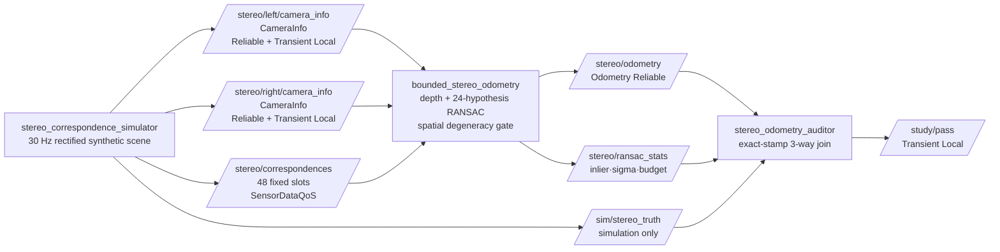
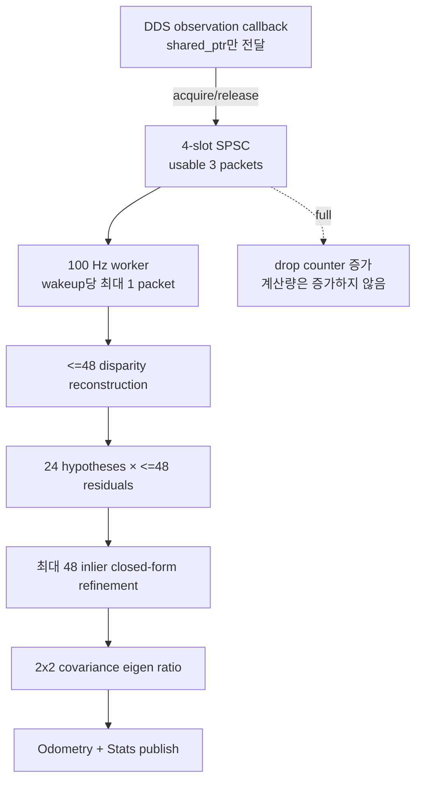

# 2026-10-26 — Stereo 깊이 불확실성, Bounded RANSAC, 공간 퇴화 감시

오늘은 어제의 단안 feature tracking에서 한 단계 나아가 **metric scale이 관찰되는 rectified stereo**를 다룬다. `CameraInfo::P`에서 baseline을 복원하고, disparity를 3D로 바꾸며, 최대 48개 correspondence와 정확히 24개 hypothesis만 쓰는 기하 RANSAC으로 frame-to-frame odometry를 계산한다. depth가 멀수록 커지는 불확실성을 residual gate에 연결하고, inlier가 한 줄에 몰리는 공간 퇴화까지 별도 지표로 감시한다.

## 학습 순서 (Reading Order)

1. 이 README의 **구조도 → CameraInfo/깊이 식 → bounded 작업량 표**를 먼저 읽는다.
2. [`msg/StereoCorrespondences.msg`](msg/StereoCorrespondences.msg)에서 고정 길이 sensor boundary를 확인한다.
3. [`src/stereo_correspondence_simulator.cpp`](src/stereo_correspondence_simulator.cpp)에서 rectified `P` 행렬과 합성 outlier 생성을 읽는다.
4. [`src/bounded_stereo_odometry.cpp`](src/bounded_stereo_odometry.cpp)에서 disparity Jacobian, 2-point SE(2), consensus refinement, eigenvalue ratio를 수식과 대조한다.
5. [`src/stereo_odometry_auditor.cpp`](src/stereo_odometry_auditor.cpp)에서 topic 도착 순서와 무관한 exact-stamp 검증을 확인한다.
6. [`paper_review.md`](paper_review.md)에서 RANSAC 원 논문의 문제 정의, 성공확률 직관, 제품 한계를 읽는다.

## 오늘의 세 영역

- **기초 실무:** `sensor_msgs/CameraInfo`의 `K/P`, optical frame, acquisition stamp, `nav_msgs/Odometry`, sensor/calibration별 QoS 계약.
- **심화·RT:** 4-slot SPSC pointer handoff, wakeup당 1 packet, 최대 48 match, 고정 24 hypothesis, fixed array, drop/budget telemetry.
- **알고리즘(SLAM/VO):** stereo triangulation과 Jacobian 기반 depth sigma, 2-point SE(2) RANSAC, inlier 전체 closed-form refinement, image-plane 공간 퇴화 감시.

## 시스템 구조도



RT 경계는 다음과 같다.



## 1. 기초 — rectified stereo와 ROS 2 메시지 계약

### `CameraInfo::K`와 `P`

왼쪽 rectified camera의 intrinsic은 다음과 같다.

\[
K=\begin{bmatrix} f_x&0&c_x\\0&f_y&c_y\\0&0&1\end{bmatrix}
\]

오른쪽 projection matrix는 x축 baseline `B`를 포함한다.

\[
P_R=\begin{bmatrix}f_x&0&c_x&-f_xB\\0&f_y&c_y&0\\0&0&1&0\end{bmatrix},
\qquad B=-P_R(0,3)/P_R(0,0)
\]

코드는 baseline을 별도 parameter로 몰래 중복하지 않고 오른쪽 `P`에서 복원한다. 좌/우 image가 rectification되지 않았거나 focal length가 다르면 `u_L-u_R`만으로 아래 식을 쓰면 안 된다.

### disparity에서 metric depth로

rectified stereo에서 같은 landmark의 수평 disparity를 `d=u_L-u_R`라 하면

\[
Z=\frac{f_xB}{d},\qquad X=\frac{(u_L-c_x)Z}{f_x}.
\]

`d`는 pixel, `f_x`는 pixel이므로 둘이 소거되고 `B`의 단위인 m로 `Z`가 나온다. `header.stamp`는 estimator 도착 시간이 아니라 좌/우 영상이 대표하는 **acquisition time**이어야 한다. 오늘의 custom message는 feature detector/descriptor 단계가 끝났다는 가정 아래 이전/현재 `u,v,d`를 각 48개 fixed array로 전달한다.

### QoS 선택

- `CameraInfo`: `Reliable + Transient Local + KeepLast(1)`. 늦게 시작한 subscriber도 마지막 calibration을 받아야 한다.
- correspondence: `SensorDataQoS`. 최신 frame이 중요하고 stale backlog를 오래 처리하지 않는다.
- odometry/stats: `Reliable + KeepLast(10)`. auditor가 같은 stamp의 두 출력을 잃지 않게 한다.
- `/study/pass`: `Reliable + Transient Local`. smoke subscriber가 늦게 떠도 최종 판정을 받는다.

QoS는 정확도/실시간성 계약의 일부다. publisher와 subscriber의 reliability/durability가 호환되지 않으면 callback은 아예 실행되지 않을 수 있다.

## 2. 심화·RT — 평균 속도가 아니라 최대 작업량을 설계한다

| 경계 | 오늘의 상한 | 넘었을 때 |
|---|---:|---|
| correspondence packet | 48 slots | `count > 48`이면 계약 위반으로 skip |
| SPSC ring | 4 slots, usable 3 | newest callback에서 drop counter 증가 |
| worker drain | 1 packet / 10 ms wakeup | backlog를 한 번에 처리하지 않음 |
| RANSAC hypothesis | 정확히 최대 24 | adaptive 무한 반복 없음 |
| hypothesis score | 48 residual 이하 | `24 × 48 = 1,152` residual 상한 |
| consensus refinement | 최대 48, 고정 pass | heap 성장/반복 수렴 없음 |
| degeneracy 검사 | 2×2 covariance closed form | 일반 eigen solver 없음 |

`std::array`가 있다고 자동으로 RT가 되는 것은 아니다. DDS receive, ROS executor, publish serialization, 일반 Linux scheduler는 여전히 지연 변동을 만든다. 오늘 계측하는 `latest/max_kernel_us`는 reconstruction부터 stats 구성 전까지의 한 환경 관측값이지 WCET 증명이 아니다. 제품에서는 PREEMPT_RT, CPU affinity, allocator/page fault, RMW 구현, camera driver buffer까지 함께 측정해야 한다.

## 3. 알고리즘 — 불확실성을 아는 기하 RANSAC

### 왜 먼 stereo point가 더 불안정한가

`Z=f_xB/d`를 disparity로 미분하면

\[
\left|\frac{\partial Z}{\partial d}\right|=\frac{f_xB}{d^2},\qquad
\sigma_Z\approx\frac{f_xB}{d^2}\sigma_d.
\]

같은 subpixel 오차라도 disparity가 작은 먼 점의 `sigma_Z`는 훨씬 크다. 오늘의 합성 noise model은 `sigma_d=0.04 px`이고, 코드는 두 frame의 depth sigma를 합쳐 각 match의 inlier threshold를 만들되 `0.035–0.18 m`로 clamp한다. clamp가 없으면 아주 먼 잘못된 점 하나가 gate를 지나치게 느슨하게 만들 수 있다.

### 2-point SE(2) hypothesis

현재 camera 좌표의 점 `p_c`와 이전 camera 좌표의 점 `p_p` 관계를

\[
p_p=R(\Delta\theta)p_c+t
\]

로 둔다. 두 점 쌍의 연결 vector angle 차이로 `Delta theta`를 구하고, 한 점을 대입해 `t`를 얻는다. 24개의 결정론적 pair를 평가해 inlier 수가 가장 많고 normalized residual이 작은 hypothesis를 고른다. 그 inlier 전체의 centroid와 2D cross-covariance로 회전/이동을 한 번 다시 계산한다.

결정론적 pair schedule은 runtime과 재현성이 좋지만, 입력 ordering을 아는 adversary가 모든 pair에 outlier를 심을 수 있다. 안전·보안 요구가 있는 제품은 bounded 난수 seed, PROSAC류 quality ordering, 또는 독립 geometric gate를 검토해야 한다.

### inlier 수만으로 충분하지 않은 이유

feature 40개가 모두 영상의 한 줄에 몰려도 inlier 수는 높다. 그러나 특정 방향 이동/회전은 약하게 관찰된다. 현재 inlier의 normalized image 좌표 covariance를

\[
C=\begin{bmatrix}C_{uu}&C_{uv}\\C_{uv}&C_{vv}\end{bmatrix}
\]

로 만들고 `lambda_min/lambda_max`를 계산한다. 0에 가까우면 선형 배치, 1에 가까우면 두 방향으로 고른 배치다. 오늘은 `0.015` 미만을 공간 퇴화로 보고 pose 누적을 막는다. 이 값은 보편 상수가 아니라 camera FOV와 scene에 맞춰 validation해야 한다.

## 파일 지도

- `CMakeLists.txt`, `package.xml`: 두 custom message와 세 C++17 executable을 정의한다.
- `msg/StereoCorrespondences.msg`: 최대 48개의 이전/현재 rectified match.
- `msg/StereoRansacStats.msg`: inlier, depth sigma, 공간 조건, 계산시간, drop telemetry.
- `src/stereo_correspondence_simulator.cpp`: `CameraInfo`, 1/7 gross outlier, exact-stamp truth 생성.
- `src/bounded_stereo_odometry.cpp`: SPSC handoff, stereo reconstruction, bounded RANSAC, odometry.
- `src/stereo_odometry_auditor.cpp`: 100 sample 위치/yaw RMSE와 모든 경계 독립 검증.
- `launch/study.launch.py`: 세 프로세스를 함께 실행한다.
- `test/smoke_test.sh`: bounded timeout으로 `/study/pass=true`를 확인한다.

## 빌드와 실행

ROS 2 Jazzy 환경에서 저장소 루트를 workspace로 사용할 때:

```bash
source /opt/ros/jazzy/setup.bash
colcon build --packages-select daily_robotics_2026_10_26 --cmake-args -DCMAKE_BUILD_TYPE=Release
source install/setup.bash
ROS_DOMAIN_ID=194 ros2 launch daily_robotics_2026_10_26 study.launch.py
```

다른 터미널에서 핵심 출력을 확인한다.

```bash
source /opt/ros/jazzy/setup.bash
source install/setup.bash
ROS_DOMAIN_ID=194 ros2 topic echo --once /stereo/ransac_stats
ROS_DOMAIN_ID=194 ros2 topic echo --once /study/pass
```

## 자체 검증 기준

`test/smoke_test.sh`는 100개의 동일 stamp sample을 모아 다음을 동시에 요구한다.

- 위치 RMSE `< 0.070 m`, 최대 위치 오차 `< 0.150 m` (약 5 m 누적 이동에서 3% 이내)
- yaw RMSE `< 0.020 rad`, 최대 yaw 오차 `< 0.040 rad`
- 모든 sample의 inlier `>= 36`, 공간 eigen ratio `>= 0.015`
- normalized residual RMSE `<= 1.0`, 유효 hypothesis `>= 20`
- calibration/공간/bounded 계약 전부 true, SPSC drop `0`

이 합성 시험은 수식/메시지/실행 경계의 회귀를 잡는다. 실제 stereo의 rolling shutter, 좌우 시간차, rectification 오차, exposure 변화, 반복 texture, dynamic object, calibration drift를 입증하지 않는다.

### 2026-10-26 관측 결과

공식 `ros:jazzy-ros-base` 컨테이너(GCC 13.3, Fast DDS)에서 Release 1회와 RelWithDebInfo 2회를 빌드·실행했다. 세 실행 모두 compiler warning 없이 build되고 smoke test를 통과했다.

- 100 exact-stamp sample의 위치 RMSE: `0.044480–0.054681 m`
- 실행별 최대 위치 오차: `0.103244–0.121750 m`
- yaw RMSE / 전체 최대 yaw 오차: `0.004314–0.007743 rad` / `0.014582 rad`
- 최소 inlier `41/48`, 최소 공간 eigen ratio `0.2464`, 최대 normalized residual RMSE `0.2933`
- 최대 보고 depth sigma `0.3428 m`, SPSC drop `0`
- 관측된 최대 numerical kernel 시간 `45.605–63.965 us`

이 값은 작은 합성 데이터와 Docker 환경에서 관측한 수치이며 WCET, 실제 camera 정확도, hard-RT 보장이 아니다.

## 다음 실습

1. 모든 점을 image 중앙의 한 줄에 놓고 `spatial_eigen_ratio`가 내려가는지 확인한다.
2. baseline을 절반으로 줄여 같은 disparity noise에서 `sigma_Z`와 pose 오차가 어떻게 변하는지 비교한다.
3. 24 fixed pair와 seeded bounded random pair의 worst-case ordering을 비교한다.
4. SE(2)를 quaternion/translation을 포함한 3D PnP로 확장하되 match/hypothesis 상한을 먼저 정한다.

## 참고 자료

- [ROS 2 Jazzy QoS settings](https://docs.ros.org/en/jazzy/Concepts/Intermediate/About-Quality-of-Service-Settings.html)
- [ROS 2 custom interfaces tutorial](https://docs.ros.org/en/jazzy/Tutorials/Beginner-Client-Libraries/Custom-ROS2-Interfaces.html)
- [`sensor_msgs/CameraInfo` message](https://docs.ros.org/en/jazzy/p/sensor_msgs/msg/CameraInfo.html)
- [`nav_msgs/Odometry` message](https://docs.ros.org/en/jazzy/p/nav_msgs/msg/Odometry.html)
- [Fischler & Bolles, “Random Sample Consensus” (CACM 1981)](https://doi.org/10.1145/358669.358692)
- [원 논문 PDF 사본 (Stanford Graphics)](https://graphics.stanford.edu/courses/cs233-21-spring/ReferencedPapers/ransac.pdf)
