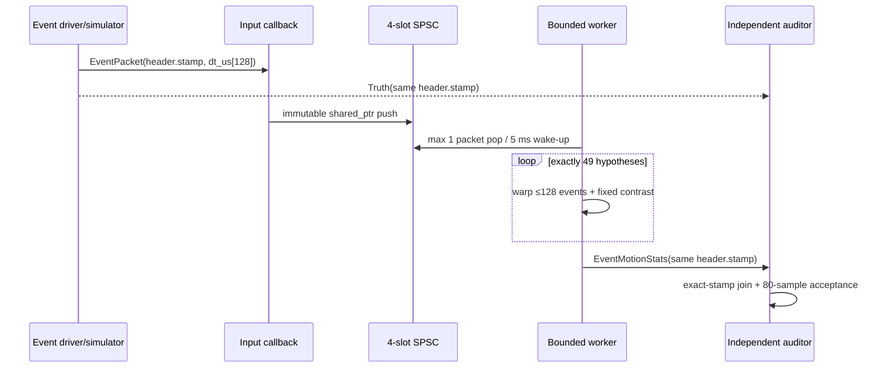

# 2026-10-27 — Event Camera 시간 계약, Bounded Contrast Maximization, Optical Flow

오늘의 핵심은 **비동기 event를 frame처럼 취급하지 않고 각 event의 측정시각을 보존한 채 motion compensation하는 것**이다. ROS 2에서는 `Header.stamp`를 packet 기준 시각으로, `dt_us[i]`를 개별 event의 상대 측정시각으로 정의한다. RT 경로에서는 128-event 고정 배열, 4-slot SPSC, 정확히 49개 속도 가설, 64×48×2 고정 histogram, wake-up당 packet 하나로 계산량 상한을 만든다. 알고리즘은 후보 속도로 event를 기준 시각에 warp하고, 가장 높은 contrast를 만드는 2D optical flow를 선택한다.

> 결과를 먼저 말하면: 공식 `ros:jazzy-ros-base`의 GCC 13.3/Fast DDS에서 Release 빌드와 통합 smoke test가 통과했다. 80개 exact-stamp sample에서 flow RMSE와 최대 오차는 모두 `0.000000 px/s`, 최소 peak ratio는 `4.031579`, queue drop은 0, 관측된 최대 kernel 시간은 `863.682 us`였다. 이는 작은 합성 입력의 Docker 관측값이며 WCET 또는 실제 event sensor 성능 보증이 아니다.

## 학습 순서 (Reading Order)

1. 이 문서의 구조도와 **기초** 절에서 event packet의 stamp/frame/polarity 계약을 이해한다.
2. [`msg/EventPacket.msg`](msg/EventPacket.msg)에서 가변 sequence 대신 128개 fixed array를 사용한 이유를 확인한다.
3. [`src/event_packet_simulator.cpp`](src/event_packet_simulator.cpp)에서 `x(t)=x_ref+v(t-t_ref)`가 event 좌표로 만들어지는 과정을 읽는다.
4. [`src/bounded_contrast_flow.cpp`](src/bounded_contrast_flow.cpp)에서 SPSC handoff, bounded worker, warp, contrast 계산을 수식과 연결한다.
5. [`src/event_flow_auditor.cpp`](src/event_flow_auditor.cpp)에서 topic 도착 순서가 아니라 acquisition stamp로 truth와 결과를 join하는 방법을 본다.
6. [`paper_review.md`](paper_review.md)에서 Gallego 등의 CVPR 2018 contrast-maximization 논문과 오늘 구현의 차이를 확인한다.
7. [`event_camera_architecture.html`](event_camera_architecture.html)에서 탐색형 구조도를 열어 data path와 audit path를 분리해 본다.
8. 공용 노트 [`../../knowledge/sensors/event_camera_packet_contract.md`](../../knowledge/sensors/event_camera_packet_contract.md)와 [`../../knowledge/realtime/bounded_event_contrast_maximization.md`](../../knowledge/realtime/bounded_event_contrast_maximization.md)를 복습한다.

## 오늘의 세 영역

| 영역 | 오늘의 주제 | 실무 질문 |
|---|---|---|
| 기초 실무 | ROS 2 custom interface, `Header`, acquisition timestamp, optical frame, SensorDataQoS | packet 시각과 개별 event 시각을 어떻게 함께 전달할까? |
| 심화·RT | fixed array, 4-slot SPSC, callback group 격리, 1 packet/wakeup, telemetry | 평균 처리량이 아니라 callback당 최악 작업량을 어떻게 제한할까? |
| 알고리즘 | event warp와 contrast maximization 기반 2D optical flow | 어떤 속도가 시간축으로 퍼진 edge event를 가장 선명하게 정렬하는가? |

## 시스템 구조도

```mermaid
graph LR
    SIM["event_packet_simulator\n100 Hz / 128 events"]
    SUB["Input callback group\nSensorDataQoS subscriber"]
    Q["4-slot SPSC ring\nshared_ptr handoff"]
    WORK["Worker callback group\n200 Hz / max 1 packet"]
    WARP["49 velocity hypotheses\n64×48×2 fixed histogram"]
    STATS["EventMotionStats\nReliable"]
    AUDIT["event_flow_auditor\nexact-stamp join"]
    PASS["/study/pass\nTransient Local"]

    SIM -->|"/event_camera/events\nEventPacket · Best Effort"| SUB
    SUB -->|"release/acquire"| Q
    Q --> WORK
    WORK --> WARP
    WARP -->|"/event_camera/motion_stats"| STATS
    STATS --> AUDIT
    SIM -.->|"/sim/event_flow_truth\n테스트 전용"| AUDIT
    AUDIT --> PASS
```



두 callback group은 `MultiThreadedExecutor(2)`가 서비스한다. 이 그림의 격리는 ROS callback ownership을 분명히 할 뿐이다. `SCHED_FIFO`, CPU affinity, IRQ/RMW thread 설정을 하지 않았으므로 hard real-time 구조라고 부르면 안 된다.



## 1. 기초 — frame이 아니라 event의 시간을 보존한다

### `Header.stamp`와 `dt_us`

오늘의 `EventPacket` 계약은 다음과 같다.

- `header.stamp`: packet의 기준 시각 `t_ref`, 즉 마지막 event가 정렬될 시각
- `header.frame_id`: 좌표 `(x,y)`가 정의된 `event_camera_optical_frame`
- `dt_us[i]`: `t_i - t_ref`를 microsecond로 저장한 값이므로 항상 `[-40000, 0]`
- `polarity[i]`: log intensity 증가 event면 `true`, 감소 event면 `false`
- `count`: fixed array 128칸 중 실제로 유효한 앞부분의 길이

`header.stamp` 하나만 모든 event의 시각이라고 간주하면 packet 내부 motion이 사라진다. 반대로 event마다 절대 ROS time 메시지를 반복하면 wire size와 parsing cost가 커진다. 기준 시각 하나와 signed offset 배열은 둘 사이의 실용적인 계약이다.

### fixed array와 bounded sequence의 차이

`uint16[128] x`는 생성된 C++에서 `std::array<uint16_t, 128>`이 된다. 크기가 type에 들어가므로 storage 상한이 컴파일 시점에 정해진다. 실제 driver가 packet마다 event 수를 바꿔야 해도 `count<=128`만 바꾸고 storage capacity는 변하지 않는다.

이 선택이 DDS 내부의 모든 allocation을 자동 제거하지는 않는다. 그러나 application hot path의 payload 크기와 반복 횟수는 명확히 제한한다. 더 큰 burst를 처리해야 한다면 array를 무작정 키우기보다 packet 분할, drop policy, producer rate, executor budget을 함께 다시 설계해야 한다.

### QoS를 topic 의미에 맞춘다

`/event_camera/events`는 과거 packet backlog보다 최신 event가 중요하므로 `rclcpp::SensorDataQoS()`를 쓴다. 이는 센서 stream에 맞춘 작은 history와 best-effort 성격을 제공한다. 반면 `/event_camera/motion_stats`와 truth는 검증 누락을 피하려고 Reliable을 사용한다. `/study/pass`는 늦게 시작한 smoke test도 마지막 결과를 받도록 Reliable + Transient Local이다.

## 2. 심화·RT — 계산량 상한을 코드 구조로 보이게 한다

### callback은 ownership만 넘긴다

DDS subscription callback은 `ConstSharedPtr`를 4-slot SPSC ring에 넣는다. 무거운 warp와 histogram 계산을 subscription callback에서 하지 않으므로, sensor 수신 경로와 numerical kernel의 책임이 분리된다.

SPSC의 핵심 순서는 다음과 같다.

1. producer가 slot payload를 기록한다.
2. `head.store(..., memory_order_release)`로 기록 완료를 공개한다.
3. consumer가 `head.load(memory_order_acquire)`로 payload를 안전하게 관측한다.

이 ring은 producer 하나와 consumer 하나일 때만 맞다. subscriber나 worker가 둘 이상이면 그대로 재사용할 수 없다.

### wake-up당 최대 작업량

한 worker wake-up의 최대 작업은 아래처럼 고정된다.

\[
N_{hyp}=7\times7=49,\qquad N_e\le128,\qquad N_{bin}=2\times64\times48=6144
\]

후보 하나마다 histogram 6144칸을 지우고, 최대 128 events를 warp하고, 6144칸의 제곱합을 계산한다. 따라서 구현의 큰 항은 대략 `49 × (2 × 6144 + 128)`회의 단순 연산이다. 더 많은 packet이 쌓여도 한 callback이 ring 전체를 비우지 않는다. ring이 차면 `queue_drops`가 증가한다.

이것은 **bounded**이지 자동으로 **deadline-safe**인 것은 아니다. 실제 제품에서는 동일 compiler/CPU/thermal/DDS 부하 조건에서 tail latency를 측정하고, 필요하면 histogram의 active-bin 목록, coarse-to-fine search, SIMD, 별도 RT thread를 검토해야 한다.

## 3. 알고리즘 — event를 가장 선명하게 만드는 속도

event `e_k=(x_k,y_k,t_k,p_k)`와 후보 optical flow `v=(v_x,v_y)`가 있을 때 기준 시각 `t_ref`로 warp한다.

\[
x'_k=x_k+v_x(t_{ref}-t_k),\qquad
y'_k=y_k+v_y(t_{ref}-t_k)
\]

올바른 속도라면 같은 moving edge가 만든 event들이 `(x',y')`의 같은 위치에 모인다. 양·음 polarity를 별도 histogram에 누적하고, image of warped events `H_v`의 분산을 contrast로 사용한다.

\[
C(v)=\frac{1}{M}\sum_{u=1}^{M}H_v(u)^2-
\left(\frac{1}{M}\sum_{u=1}^{M}H_v(u)\right)^2
\]

오늘 코드는 `v_x,v_y∈{-300,-200,-100,0,100,200,300}`을 모두 평가하고 `argmax C(v)`를 고른다. gradient optimizer보다 정밀도는 낮지만, 49개라는 명확한 상한과 전역 grid 비교가 교육용 RT kernel에 유리하다.

### peak ratio가 필요한 이유

최댓값 하나만 보고 속도를 publish하면 무텍스처, 한 방향 edge, event 부족 상황에서도 그럴듯한 숫자가 나온다. 따라서 `best_contrast / second_contrast`를 함께 내보내고 오늘은 `>1.001`일 때만 observable로 본다. 실제 시스템에서는 인접 후보를 제외한 non-maximum suppression, Hessian/curvature, spatial coverage, polarity balance까지 함께 진단해야 한다.

## 파일 지도

| 파일 | 역할 |
|---|---|
| `msg/EventPacket.msg` | timestamp offsets와 polarity를 가진 최대 128-event wire contract |
| `msg/EventMotionStats.msg` | 속도, contrast peak, 작업량, drop, kernel 시간 telemetry |
| `src/event_packet_simulator.cpp` | 알려진 등속 flow로 100 Hz synthetic event packet과 독립 truth 생성 |
| `src/bounded_contrast_flow.cpp` | SPSC handoff와 49-hypothesis contrast-maximization kernel |
| `src/event_flow_auditor.cpp` | exact-stamp truth/result join과 80-sample acceptance test |
| `launch/study.launch.py` | 세 노드 통합 실행 |
| `test/smoke_test.sh` | bounded timeout을 둔 end-to-end 검증 |
| `paper_review.md` | CVPR 2018 논문을 엔지니어 관점에서 해설 |
| `event_camera_architecture.html` | light/dark theme과 focus view를 가진 독립 HTML 구조도 |
| `event_camera_architecture.json` | Archify 구조도의 검증 가능한 source specification |

## 빌드와 실행

ROS 2 Jazzy 환경에서 저장소 루트를 workspace source로 지정한다.

```bash
source /opt/ros/jazzy/setup.bash
colcon build \
  --base-paths daily_robotics/2026-10-27 \
  --cmake-args -DCMAKE_BUILD_TYPE=Release
source install/setup.bash
ros2 launch daily_robotics_2026_10_27 study.launch.py
```

통합 acceptance test는 다음처럼 실행한다.

```bash
ROS_DOMAIN_ID=198 \
  install/daily_robotics_2026_10_27/lib/daily_robotics_2026_10_27/smoke_test.sh
```

## 자체 검증 기준

- custom messages와 세 C++17 executable이 `-Wall -Wextra -Wpedantic -Wconversion -Wshadow`에서 컴파일될 것
- 80개 truth/stats pair가 동일 acquisition stamp로 결합될 것
- flow RMSE와 최대 오차가 각각 `1.0 px/s` 이하일 것
- 모든 packet이 128 valid events, 모든 kernel이 정확히 49 hypotheses를 처리할 것
- peak ratio가 `1.001`보다 크고, 모든 contract/bounds flag가 true일 것
- queue drop이 0일 것
- smoke test가 35초 안에 `/study/pass: true`를 받을 것

### 2026-10-27 관측 결과

- 환경: 공식 `ros:jazzy-ros-base`, GCC 13.3, Fast DDS, Release
- 결과: `colcon build` 경고 없이 통과, 통합 smoke 통과
- exact-stamp samples: 80
- flow RMSE / max error: `0.000000 / 0.000000 px/s`
- minimum events / hypotheses: `128 / 49`
- minimum peak ratio: `4.031579`
- maximum observed kernel time: `863.682 us`
- queue drops: `0`

관측값은 64×48 synthetic event, 알려진 등속 이동, idle Docker 환경의 결과다. 실제 event camera의 timestamp jitter, hot pixels, refractory behavior, background activity, non-uniform motion, rolling calibration drift를 포함하지 않으며 WCET 증명이 아니다.

## 다음 실습

1. coarse 7×7 grid 주변만 finer grid로 재평가하되 총 hypothesis 상한을 유지한다.
2. active histogram bin 목록으로 전체 6144-bin scan을 줄이고 결과 동등성을 property test한다.
3. 한 방향 edge만 넣어 aperture problem을 재현하고 Hessian eigenvalue 기반 observability gate를 추가한다.
4. 실제 event-camera message/driver를 adapter node로 연결하되 오늘의 내부 fixed contract는 유지한다.

## 참고 자료

- [ROS 2 Jazzy — About Quality of Service settings](https://docs.ros.org/en/jazzy/Concepts/Intermediate/About-Quality-of-Service-Settings.html)
- [ROS 2 Jazzy — Creating custom msg and srv files](https://docs.ros.org/en/jazzy/Tutorials/Beginner-Client-Libraries/Custom-ROS2-Interfaces.html)
- [ROS 2 Jazzy `std_msgs/Header`](https://docs.ros.org/en/jazzy/p/std_msgs/msg/Header.html)
- [Gallego, Rebecq, Scaramuzza, “A Unifying Contrast Maximization Framework for Event Cameras,” CVPR 2018](https://openaccess.thecvf.com/content_cvpr_2018/html/Gallego_A_Unifying_Contrast_CVPR_2018_paper.html)
- [논문 PDF](https://openaccess.thecvf.com/content_cvpr_2018/papers/Gallego_A_Unifying_Contrast_CVPR_2018_paper.pdf)
- [DOI: 10.1109/CVPR.2018.00407](https://doi.org/10.1109/CVPR.2018.00407)
