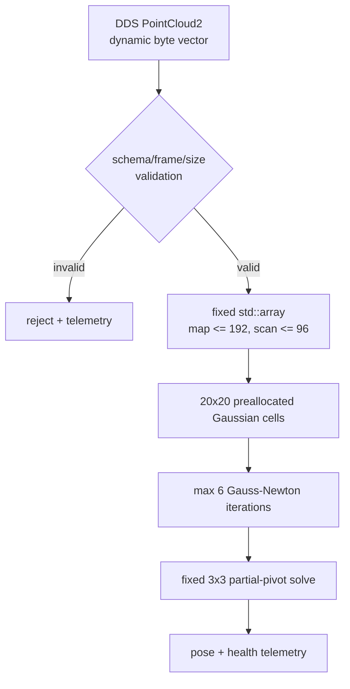

# 2026-11-10 — PointCloud2/QoS 계약, Bounded NDT, 독립 자세 감사

> **오늘의 핵심:** `PointCloud2`의 schema·취득 시각·frame과 정적 map/연속 sensor stream의 QoS를 구분한다. ROS의 가변 길이 byte buffer는 callback 경계에서 검증해 고정 배열로 복사하고, 20×20 Gaussian grid와 최대 6회 Gauss–Newton으로 2D NDT scan matching을 수행한다. 별도 노드가 동일 acquisition stamp의 ground truth와 추정치를 짝지어 정확도·solver 실패·계산시간을 독립 감사한다.

## 학습 순서 (Reading Order)

1. 이 문서의 통신 구조와 세 영역을 훑어 전체 데이터 흐름을 잡는다.
2. [`../../knowledge/slam/normal_distributions_transform.md`](../../knowledge/slam/normal_distributions_transform.md)에서 Gaussian cell과 Mahalanobis 목적함수를 읽는다.
3. [`src/pointcloud_pair_source.cpp`](src/pointcloud_pair_source.cpp)에서 `PointCloud2`의 `fields/point_step/row_step/data`, frame, QoS를 확인한다.
4. [`src/bounded_ndt_matcher.cpp`](src/bounded_ndt_matcher.cpp)에서 schema 방어, 고정 배열 경계, 공분산 정칙화, Jacobian과 3×3 solve를 수식과 연결한다.
5. [`src/ndt_auditor.cpp`](src/ndt_auditor.cpp)에서 exact-stamp join과 독립 합격 조건을 읽는다.
6. [`paper_review.md`](paper_review.md)에서 Biber–Straßer NDT 원 논문이 무엇을 해결했고 오늘 코드가 무엇을 단순화했는지 구분한다.
7. 빌드·smoke test 뒤 `valid_points`, `minimum_hessian_pivot`, `kernel_time_us`를 함께 관찰한다.

## 오늘의 세 영역

| 영역 | 학습 내용 | 실무에서 놓치기 쉬운 점 |
|---|---|---|
| 기초 실무 | ROS 2 Topic, `PointCloud2` binary schema, `header.stamp/frame_id`, SensorDataQoS와 Transient Local map | 같은 C++ type이어도 QoS가 호환되지 않으면 연결되지 않는다. `data`를 `float*`로 무조건 cast하면 offset/endian/alignment 계약을 깨뜨린다. |
| 심화/RT | 동적 ROS 경계 → 최대 192/96점 고정 배열, 20×20 cell, 6회 반복, 3×3 partial-pivot solve | bounded는 hard RT 증명이 아니다. DDS·executor·page fault·logging·CPU preemption은 이 커널 밖에 남는다. |
| 알고리즘 | 2D NDT의 cell 평균/공분산, Mahalanobis residual, SE(2) Jacobian, Gauss–Newton | 초기값, cell 크기, 환경 기하, covariance conditioning이 나쁘면 local optimum 또는 관측 불능이 된다. |

## ROS 노드 통신 구조

```mermaid
graph LR
    SRC[pointcloud_pair_source<br/>10 Hz synthetic acquisition]
    MAP[/ndt/reference<br/>PointCloud2<br/>Reliable + Transient Local]
    SCAN[/ndt/scan<br/>PointCloud2<br/>SensorDataQoS KeepLast 1]
    TRUTH[/ndt/truth<br/>NdtTruth<br/>same acquisition stamp]
    NDT[bounded_ndt_matcher<br/>192/96 fixed points<br/>20x20 cells x max 6 iterations]
    STATS[/ndt/stats<br/>NdtStats]
    AUDIT[ndt_auditor<br/>128-slot exact-stamp join]
    PASS[/study/pass<br/>Bool durable verdict]

    SRC --> MAP --> NDT
    SRC --> SCAN --> NDT
    SRC --> TRUTH --> AUDIT
    NDT --> STATS --> AUDIT
    AUDIT --> PASS
```

### 실시간 경계



이 선은 “ROS 전체가 무할당”이라는 뜻이 아니다. `PointCloud2::data`, DDS 수신, executor, 로그는 여전히 동적일 수 있다. 오늘의 보장은 **메시지를 내부 배열로 복사한 뒤 NDT 수치 커널의 메모리와 반복 횟수에 상한이 있다**는 범위로 제한한다.

## 1. 기초 실무 — PointCloud2와 QoS를 데이터 계약으로 읽기

`PointCloud2`는 `std::vector<PointXYZ>`가 아니다. `fields`가 각 채널의 이름·offset·datatype을 설명하고, 한 점의 byte 수는 `point_step`, 한 행의 byte 수는 `row_step`, 실제 payload는 `data`에 있다. 따라서 소비자는 최소한 다음을 확인해야 한다.

- `header.stamp`: sensor acquisition 시각인지 driver publish 시각인지 장치 계약과 함께 확인한다.
- `header.frame_id`: 점 좌표가 표현된 frame이다. 오늘 reference는 `map`, current scan은 `lidar`다.
- `height/width/point_step/row_step/data.size()`: 선언된 shape와 실제 buffer가 맞는지 검사한다.
- `fields`: `x/y`가 `FLOAT32`, `count=1`, offset이 point boundary 안에 있는지 검사한다.
- `is_bigendian/is_dense`: byte order와 NaN 가능성을 명시한다. 오늘 학습 코드는 little-endian만 받되 각 점의 finite 여부도 검사한다.

QoS도 type의 일부처럼 취급해야 한다. 정적 reference map은 늦게 시작한 matcher도 마지막 한 장을 받아야 하므로 `Reliable + TransientLocal + KeepLast(1)`이다. current scan은 오래된 관측을 쌓기보다 최신성을 우선해 `SensorDataQoS + KeepLast(1)`이다. publisher와 subscriber의 requested/offered QoS가 호환되지 않으면 topic 이름과 message type이 같아도 데이터가 오지 않는다.

## 2. 심화/RT — 계산 상한과 수치 건전성을 함께 설계하기

오늘 matcher의 hot path 상한은 다음과 같다.

| 항목 | 상한/정책 | 이유 |
|---|---:|---|
| reference points | 192 | 교육용 map build 비용과 memory를 제한 |
| current scan points | 96 | scan당 work를 제한하고 초과점은 명시적으로 reject count에 기록 |
| NDT grid | 20×20 = 400 cells | hash/heap 없이 고정 주소로 접근 |
| valid cell | 최소 4점, `Σ + 0.0025 I` | 선형 wall cell의 singular covariance 완화 |
| optimization | 최대 6회 | 입력이 나빠도 callback이 무한 반복하지 않음 |
| outlier gate | Mahalanobis² ≤ 25 | cell 밖의 강한 outlier가 Hessian을 지배하지 못하게 함 |
| linear solve | fixed 3×3 partial pivot | heap 없는 SE(2) update와 작은 pivot 감시 |
| trust region | `Δx,Δy ≤ 0.08 m`, `Δyaw ≤ 0.04 rad`/회 | 잘못된 cell association의 한 번짜리 폭주 제한 |

`kernel_time_us`는 관측값이지 WCET가 아니다. 실제 RT 주장은 PREEMPT_RT, CPU affinity/priority, memory locking, tracing, worst-case sensor density, RMW 설정까지 포함한 target hardware 시험이 있어야 한다. 또한 평균 오차만 보면 순간 발산을 숨길 수 있으므로 auditor는 RMSE뿐 아니라 최대 오차, 최소 사용점, solve failure와 non-convergence도 검사한다.

## 3. 알고리즘 — 2D NDT를 수식과 코드로 연결하기

reference cell `k`의 점 `p_i`로 평균과 공분산을 만든다.

\[
\mu_k = \frac{1}{n_k}\sum_i p_i,\qquad
\Sigma_k = \frac{1}{n_k-1}\sum_i(p_i-\mu_k)(p_i-\mu_k)^T + \lambda I
\]

current scan 점 `p`를 pose `ξ=[t_x,t_y,θ]^T`로 map에 옮긴 점은 다음과 같다.

\[
q(\xi)=R(\theta)p+t
\]

오늘 구현은 원 논문의 Gaussian likelihood Newton 최적화를 그대로 복제한다고 주장하지 않고, 실무에서 흔한 point-to-distribution Gauss–Newton 교육형으로 다음 Mahalanobis 제곱합을 최소화한다.

\[
E(\xi)=\sum_i r_i^T\Sigma_{k(i)}^{-1}r_i,\qquad r_i=q_i(\xi)-\mu_{k(i)}
\]

SE(2) Jacobian은 코드의 `jacobian` 배열과 직접 대응한다.

\[
J_i=
\begin{bmatrix}
1 & 0 & -\sin\theta\,p_x-\cos\theta\,p_y\\
0 & 1 &  \cos\theta\,p_x-\sin\theta\,p_y
\end{bmatrix}
\]

각 반복에서 `H=ΣJᵀΣ⁻¹J`, `g=ΣJᵀΣ⁻¹r`를 모아 `HΔ=-g`를 풀고 pose를 갱신한다. `minimum_hessian_pivot`가 작으면 공간 기하가 한 방향을 충분히 구속하지 못하거나 수치 scale이 나쁘다는 신호다.

## 독립 검증 계약

`ndt_auditor`는 `/ndt/truth`와 `/ndt/stats`를 arrival time이 아니라 동일한 `header.stamp`로 짝짓는다. topic 간 전달 순서가 뒤집힐 수 있으므로 양쪽을 최대 128개 fixed ring에 임시 보관한다. 60개 matched sample에서 다음을 모두 만족해야 `/study/pass=true`다.

- position RMSE `< 0.060 m`, yaw RMSE `< 0.030 rad`
- maximum position/yaw error `< 0.150 m / 0.080 rad`
- 모든 sample에서 valid NDT points `>= 30`
- solve failure `= 0`, non-converged sample `= 0`

합성 데이터 통과는 실센서 정확도나 안전 인증이 아니다. deskew, time synchronization, extrinsic calibration, dynamic-object rejection, global relocalization과 fail-safe는 별도 계층이다.

## 빌드와 실행

ROS 2 Jazzy workspace의 `src/` 아래에 이 폴더를 복사하거나 symlink한 뒤 실행한다.

```bash
colcon build --packages-select daily_robotics_2026_11_10 \
  --cmake-args -DCMAKE_BUILD_TYPE=Release
source install/setup.bash
ros2 launch daily_robotics_2026_11_10 study.launch.py
```

별도 터미널에서:

```bash
source install/setup.bash
ROS_DOMAIN_ID=210 ros2 run daily_robotics_2026_11_10 smoke_test.sh
```

토픽 계약 점검:

```bash
ros2 topic info /ndt/reference --verbose
ros2 topic info /ndt/scan --verbose
ros2 topic echo /ndt/stats
```

## 검증 결과

공식 `ros:jazzy-ros-base` image와 GCC 13.3에서 isolated package만 빌드했다. Release와 RelWithDebInfo 모두 compiler warning 없이 `colcon build`를 통과했고, ROS domain 211/212에서 launch와 60-sample smoke test를 각각 통과했다.

| 구성 | position RMSE / max | yaw RMSE / max | 최소 valid points | solve failure | 관측 최대 kernel time |
|---|---:|---:|---:|---:|---:|
| Release | 0.004080 / 0.004244 m | 0.001426 / 0.001447 rad | 94 | 0 | 8.643 µs |
| RelWithDebInfo | 0.004078 / 0.004232 m | 0.001425 / 0.001447 rad | 94 | 0 | 11.718 µs |

초기 검증은 벽이 정확히 0.4 m NDT cell 경계에 놓여 작은 x 이동이 빈 cell로 넘어가는 장면 설계 문제를 드러냈다(position RMSE 0.129591 m). 벽을 cell 내부로 옮긴 뒤 위의 두 독립 실행이 통과했다. 이 과정은 cell-grid 불연속과 배치 민감도 자체가 NDT의 중요한 실패 모드임을 보여준다.

위 시간은 작은 합성 cloud를 공유 CI 호스트의 Docker에서 관찰한 값이며 WCET, hard-RT 증명, 실 LiDAR 정확도 보장이 아니다.

## 확장 과제

1. 한 개 grid offset의 경계 불연속을 줄이기 위해 shifted multi-grid NDT를 추가하되 계산량 상한을 명시한다.
2. constant-velocity prediction/IMU prior를 초기값으로 넣고, prior covariance와 NDT Hessian의 정보 결합을 구현한다.
3. dynamic point mask와 robust loss를 추가하고, reject 비율이 높을 때 pose를 publish하지 않는 supervisor를 둔다.
4. 3D `SE(3)` 6×6 solve로 확장하되 voxel 수, point 수, iteration 수, condition metric의 상한을 유지한다.

## 레퍼런스

- [ROS 2 `PointCloud2.msg` 원본 정의](https://github.com/ros2/common_interfaces/blob/jazzy/sensor_msgs/msg/PointCloud2.msg)
- [ROS 2 Jazzy QoS 개념과 compatibility](https://docs.ros.org/en/jazzy/Concepts/Intermediate/About-Quality-of-Service-Settings.html)
- [ROS 2 Jazzy `SensorDataQoS` API](https://docs.ros.org/en/jazzy/p/rclcpp/generated/classrclcpp_1_1SensorDataQoS.html)
- [Biber & Straßer, “The Normal Distributions Transform: A New Approach to Laser Scan Matching,” IROS 2003](https://doi.org/10.1109/IROS.2003.1249285)
- [NDT 원문 공개본](https://citeseerx.ist.psu.edu/document?doi=1f16244ce2e78881c7c96b33796a930ce73f7972&repid=rep1&type=pdf)
